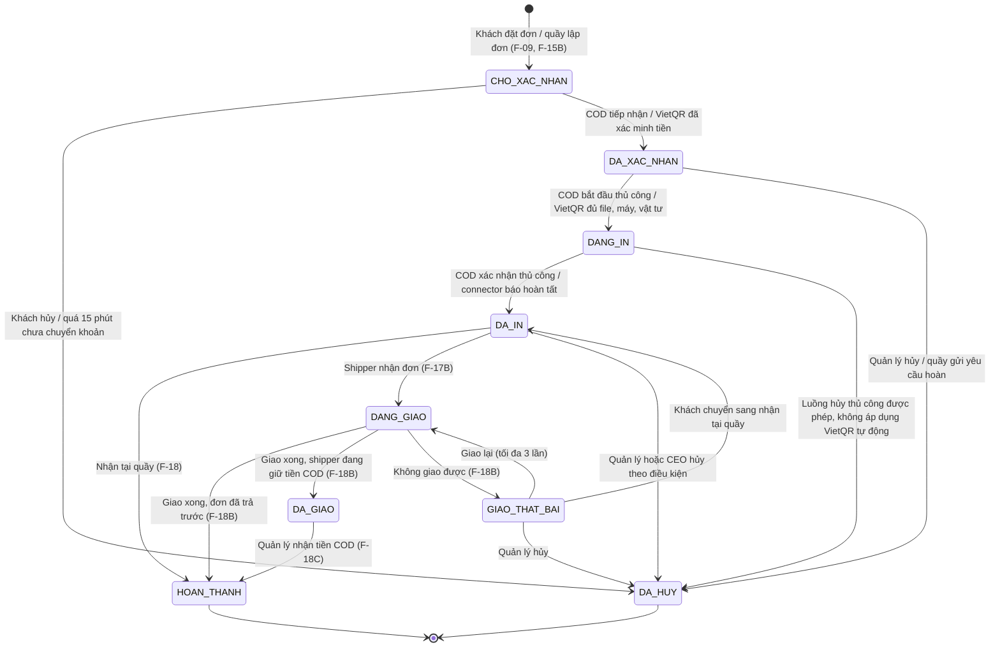

# TÀI LIỆU ĐẶC TẢ CHỨC NĂNG HỆ THỐNG

## ĐỀ TÀI: XÂY DỰNG HỆ THỐNG QUẢN LÝ DỊCH VỤ PHOTOCOPY TRỰC TUYẾN

- **Mã đề tài:** CNTT-KLCN031
- **Loại đề tài:** Ứng dụng
- **Giảng viên hướng dẫn:** Đinh Thị Tâm
- **Email GVHD:** tamdt@huit.edu.vn
- **Đơn vị đào tạo:** Khoa Công nghệ Thông tin - Trường Đại học Công Thương TP.HCM (HUIT)
- **Phiên bản:** v2.2 (07/10/2026) — cập nhật quyền CEO theo chi nhánh, bảng giá / khuyến mãi riêng, tự mở ca khi nhân viên đăng nhập, thanh toán payOS và kết nối máy in ảo; đối chiếu với mã nguồn hiện tại (xem Mục 9, 10).
- **Phạm vi đối chiếu:** mã nguồn trong `MaNguon/PhotocopyChain`, ứng dụng `MaNguon/photocopy_mobile` và các script trong `Database`. Chức năng còn thiếu hoặc khác bản v2.1 được ghi rõ ở Mục 10; không xem yêu cầu cũ là bằng chứng đã triển khai.

---

## MỤC LỤC

1. [Yêu cầu đề tài và khảo sát](#1-yêu-cầu-đề-tài-và-khảo-sát)
2. [Tổng quan hệ thống](#2-tổng-quan-hệ-thống)
3. [Phân hệ tài khoản](#3-phân-hệ-tài-khoản)
4. [Phân hệ khách hàng (Mobile App)](#4-phân-hệ-khách-hàng-mobile-app)
5. [Phân hệ nhân viên chi nhánh (Web / App Shipper)](#5-phân-hệ-nhân-viên-chi-nhánh-web--app-shipper)
6. [Phân hệ quản trị (Web)](#6-phân-hệ-quản-trị-web)
7. [Phân hệ xử lý phía máy chủ](#7-phân-hệ-xử-lý-phía-máy-chủ)
8. [Ma trận phân quyền](#8-ma-trận-phân-quyền)
9. [Lịch sử phiên bản](#9-lịch-sử-phiên-bản)
10. [Phạm vi triển khai và tiêu chí nghiệm thu](#10-phạm-vi-triển-khai-và-tiêu-chí-nghiệm-thu)

---

## 1. YÊU CẦU ĐỀ TÀI VÀ KHẢO SÁT

### 1.1. Yêu cầu đề tài gốc

- **Mục tiêu:** Xây dựng hệ thống quản lý cửa hàng photocopy giúp khách hàng đặt dịch vụ, gửi tài liệu, theo dõi đơn hàng thuận tiện; đồng thời hỗ trợ cửa hàng quản lý đơn hàng, dịch vụ, thanh toán, vật tư và doanh thu tập trung, chính xác.
- **Yêu cầu nghiệp vụ:**
  - Quản lý dịch vụ và bảng giá; tiếp nhận, kiểm tra file in; quản lý đơn hàng; phân công nhân viên xử lý; cập nhật trạng thái; ghi nhận thanh toán; quản lý kho vật tư, nhân viên và quyền truy cập; báo cáo doanh thu, đơn hàng, tồn kho; lưu trữ file, tự động đọc số trang PDF, tính giá theo cấu hình in, đồng bộ trạng thái đơn và gửi thông báo cho khách.
  - Khách hàng đăng ký tài khoản, tải tài liệu, chọn cấu hình in (khổ giấy, số lượng, màu / đen trắng, 1 mặt / 2 mặt), nhận báo giá, đặt hàng, thanh toán, theo dõi tiến độ, nhận thông báo và đánh giá dịch vụ.
- **Yêu cầu triển khai:**
  - **Web:** quản lý dịch vụ, bảng giá, file in, đơn hàng, phân công, trạng thái, thanh toán, kho vật tư, nhân viên, phân quyền và báo cáo.
  - **Mobile:** đăng ký, tải file, chọn cấu hình in, nhận báo giá, đặt hàng, thanh toán, theo dõi và đánh giá.
  - **Backend / API:** xác thực, lưu file, đọc số trang PDF, tính giá tự động, đồng bộ dữ liệu và gửi thông báo.

### 1.2. Khảo sát thực tế

Khảo sát khách hàng là sinh viên HUIT:

- 93,8% người dùng là sinh viên, nhu cầu in tăng mạnh vào mùa thi, đồ án, tiểu luận.
- 100% đã quen gửi file qua Zalo / mạng xã hội nhưng hay bị trôi tin nhắn, nhầm đơn, không biết trước giá.
- Khó khăn lớn nhất: 81,3% phải chờ lâu giờ cao điểm; 68,8% không biết trước tổng tiền; 37,5% bị lỗi nhảy trang / font Word.
- Hình thức thanh toán ưa thích: 43,8% chuyển khoản VietQR, 37,5% tiền mặt.

### 1.3. Đối chiếu yêu cầu đề tài với chức năng

| Nhóm chức năng theo đề cương | Chức năng chi tiết | Mã chức năng |
| :--- | :--- | :--- |
| Web - Quản trị hệ thống | Quản lý cơ sở in, máy in, chọn phạm vi CEO | `F-19B`, `F-19C`, `F-19D`, `F-19E` |
| | Quản lý bảng giá dịch vụ | `F-19`, `F-20` |
| | Quản lý kho vật tư | `F-22`, `F-23` |
| Web - Quản lý nhân viên | Phân quyền nhân viên | `F-24`, `F-02`, Mục 8 |
| | Phân công nhân viên xử lý | `F-21`, `F-17B` |
| Web - Quản trị viên | Quản lý file in, khôi phục tài liệu của đơn đã trả tiền | `F-16`, `F-16B`, `F-16C`, `F-31` |
| | Quản lý đơn hàng, lập đơn và xử lý phát sinh tại quầy | `F-15`, `F-15B`, `F-17`, `F-18`, `F-18D`, `F-18E`, Mục 2.4 |
| | Báo giá | `F-20`, `F-08`, `F-30` |
| | Xử lý thanh toán, yêu cầu và xác nhận hoàn tiền | `F-10`, `F-18`, `F-18B`, `F-18C`, `F-18D` |
| | Báo cáo, thống kê và theo dõi tiêu hao | `F-26`, `F-27`, `F-28` |
| Mobile - Khách hàng | Tải file | `F-01`, `F-06` |
| | Chọn cấu hình in, nhận báo giá, thanh toán | `F-07`, `F-08`, `F-09`, `F-10` |
| | Theo dõi và đánh giá | `F-11`, `F-12`, `F-13`, `F-14` |
| Backend / API | Xác thực, lưu file, đọc số trang, tính giá, đồng bộ, thông báo | `F-29` → `F-34` |
| Backend / Connector | Tự xếp in sau thanh toán, máy in ảo, chống nhận / xác nhận lệnh trùng | `F-36`, `F-37`, `F-38` |

Các chức năng `F-15B`, `F-16C`, `F-17B`, `F-18B`, `F-18C`, `F-18E`, `F-19C`, `F-19E`, `F-24B`, `F-35` → `F-38` là phần mở rộng của nhóm (nghiệp vụ tại quầy, chuỗi nhiều chi nhánh, giao hàng, ca làm việc, khuyến mãi, thanh toán thật và mô phỏng kết nối máy in).

---

## 2. TỔNG QUAN HỆ THỐNG

Hệ thống phục vụ một chuỗi cửa hàng photocopy nhiều chi nhánh, gồm 4 phần:

- **Mobile App (Flutter):** khách hàng đặt in và shipper đi giao.
- **Web quản trị (Blazor):** Super Admin, Quản lý chi nhánh, Nhân viên in.
- **API (ASP.NET Core) + SQL Server:** xử lý nghiệp vụ, lưu dữ liệu, gửi thông báo.
- **Connector máy in ảo (.NET):** chương trình `PhotocopyPrinterSimulator` chạy riêng, kết nối API qua HTTP, nhận lệnh / tải PDF / mô phỏng thời gian in / báo kết quả. Đây không phải một vai trò người dùng và không tự xác nhận tiền.

### 2.1. Vai trò

| Vai trò | Mã | Nơi dùng | Công việc chính |
| :--- | :--- | :--- | :--- |
| Chủ chuỗi (CEO) | `SUPER_ADMIN` | Web | Xem toàn chuỗi hoặc chọn một chi nhánh để thao tác như Quản lý CN; quản lý bảng giá, khuyến mãi, phê duyệt và từng bản ghi trong phạm vi đang chọn |
| Quản lý chi nhánh | `BRANCH_ADMIN` | Web | Quản lý nhân viên, máy in, kho; xác nhận ca nhân viên; nhận COD từ shipper; lập đơn, bàn giao và gửi yêu cầu hoàn tiền tại quầy |
| Nhân viên in | `STAFF` | Web | Đăng nhập tự mở / dùng lại ca; lập và tiếp nhận đơn, xử lý in thủ công COD, theo dõi in tự động VietQR, bàn giao, thu tiền và xử lý phát sinh |
| Shipper | `SHIPPER` | App | Nhận đơn đi giao, thu tiền khi giao (COD), nộp tiền về chi nhánh |
| Khách hàng | `CUSTOMER` | App | Tải file, đặt in, thanh toán, theo dõi đơn, đánh giá |

### 2.2. So sánh quyền giữa các vai trò

| Việc | Super Admin | Quản lý CN | Nhân viên in | Shipper | Khách hàng |
| :--- | :--- | :--- | :--- | :--- | :--- |
| Đặt in, tải file | Có (CN đã chọn, ca đang mở) | Có (lập đơn tại quầy) | Có (lập đơn tại quầy) | Không | Có |
| Tải file gốc, in | Có | Có | Có | Không | Không |
| Giao hàng, thu COD | Không | Không | Không | Có | Nhận hàng, trả tiền |
| Bàn giao tại quầy, thu tiền mặt | Có (CN đã chọn, ca đang mở) | Có (CN mình) | Có (CN mình) | Không | Nhận hàng, trả tiền |
| Lập yêu cầu in lại / mua thêm / xử lý hoàn tại quầy | Có (CN đã chọn, theo điều kiện từng chức năng) | Có (CN mình) | Có (CN mình) | Không | Không |
| Xác nhận đã hoàn tiền | Có | Không | Không | Không | Không |
| Nhận tiền COD vào ca | Có | Có (CN mình) | Không | Không | Không |
| Mở / đóng ca | Có (mở thủ công tại CN đã chọn) | Có (mở thủ công) | Tự mở khi đăng nhập; đóng thủ công | Không | Không |
| Xác nhận ca nhân viên in | Có | Có (CN mình, không phải ca của mình) | Không | Không | Không |
| Lập phiếu nhập | Có | Có (CN mình) | Không | Không | Không |
| Duyệt phiếu nhập | Có | Không | Không | Không | Không |
| Cấu hình bảng giá, khuyến mãi | Có (chọn CN trước khi thêm / sửa) | Xem bảng giá; quản lý khuyến mãi riêng chưa được cấp tại API | Xem bảng giá | Không | Dùng giá / mã của CN đặt đơn |
| Cấu hình chi nhánh | Có (kiểm phạm vi bản ghi) | Chỉ xem CN mình | Không | Không | Xem CN hoạt động |

- **Phạm vi:** “CN đã chọn” là chế độ `F-19E`; CEO ở chế độ toàn chuỗi xem tổng quan và thực hiện quyền cấp chuỗi, nhưng phải chọn CN trước các thao tác cần ca / bảng giá / khuyến mãi của một cơ sở.
- **Lưu ý:** quyền trên bảng không có nghĩa được bỏ qua trạng thái đơn, ca, tồn kho hay khóa lệnh máy. Những quy trình v2.1 chưa đồng bộ được đánh dấu ở Mục 10.

### 2.3. Các quy tắc kiểm soát tiền

1. **Tiền chuyển khoản VietQR** vào thẳng tài khoản của chủ chuỗi, chi nhánh không giữ.
2. **Tiền mặt luôn gắn với một ca làm việc.** Nhân viên phải mở ca mới thu được tiền mặt (`F-18`, `F-18C`). Hệ thống tự cộng tiền thu vào `DoanhThuTrongCa` của ca.
3. **Ca của Nhân viên in phải có người thứ hai xác nhận.** Nhân viên đếm tiền trong két và nhập `TongDoanhThuCuoiCa`, ca chuyển sang chờ xác nhận. Quản lý chi nhánh đó (hoặc Super Admin) kiểm đếm và xác nhận:
   - `Két phải có hiện tại = TienDauCa + DoanhThuTrongCa`. Việc tự trừ chứng từ hoàn mặt theo ca là yêu cầu v2.1 còn thiếu (Mục 10), không được mặc định đã có.
   - `Chênh lệch = TienQuanLyDemCuoiCa − Két phải có`.
   - Két thiếu: trừ khoản đã lấy từ két chi cho tiệm (`TienChi`, có ghi chú), phần còn lại nhân viên bù ngay (`TienBu`). Chưa bù đủ thì chưa xác nhận được.
   - Két thừa: phần thừa nộp về tiệm.
   - Nhân viên trực ca không tự xác nhận ca của mình. Ca của Quản lý chi nhánh đóng xong chuyển thẳng `DA_XAC_NHAN`, không qua bước người thứ hai xác nhận.
   - Chưa có chứng từ hoàn mặt riêng trong lược đồ hiện tại; phải đối chiếu khoản thực chi trước khi quyết toán, không ghi hai lần cùng một khoản chi.
4. **Shipper không tự xác nhận đã nộp tiền COD.** Quản lý CN hoặc CEO làm việc tại CN đó nhận tiền và xác nhận; tiền vào đúng ca của người nhận ở CN giữ đơn.
5. **Người lập phiếu nhập không tự duyệt.** Quản lý chi nhánh lập phiếu nhập vật tư, Super Admin duyệt. Nhân viên in / Quản lý CN chỉ gửi yêu cầu hoàn tiền; Super Admin kiểm tra và xác nhận sau khi đã trả tiền cho khách.
6. **Hoàn tiền không phải lệnh chuyển tiền tự động.** CEO trả tiền bên ngoài phần mềm rồi xác nhận tại `F-18D`. CSDL hiện tại ghi trạng thái `DA_HOAN_TIEN`; chứng từ chi tiết / ca chi và báo cáo thu ròng của v2.1 chưa đồng bộ (Mục 10).
7. Quyền được kiểm tại API và các thủ tục nghiệp vụ; ca và phiếu nhập có trigger kiểm tra người xác nhận / duyệt. CEO chọn CN phải được kiểm cả bản ghi đích, không chỉ lọc danh sách; không được tự duyệt phiếu do mình lập.
8. **Xác nhận VietQR:** chỉ nhận kết quả đã kiểm chữ ký webhook hoặc đã đối soát trực tiếp payOS. Tham số URL, ảnh chuyển khoản, nút bấm của khách và thời gian máy in chạy không chứng minh đã nhận tiền.
9. **Không ghi nhận tiền hai lần:** webhook / đối soát gửi lại không được tạo thanh toán mới, cộng két hoặc xếp lại đơn đã sang công đoạn sau. VietQR không cộng vào tiền mặt của ca.

### 2.4. Trạng thái đơn hàng

| Trạng thái | Ý nghĩa |
| :--- | :--- |
| `CHO_XAC_NHAN` | Đơn mới, chờ chi nhánh tiếp nhận (đơn chuyển khoản phải thanh toán xong mới tiếp nhận được) |
| `DA_XAC_NHAN` | COD đã được tiếp nhận; hoặc VietQR đã xác minh tiền và chờ đủ tài liệu / máy kết nối / vật tư để xếp in |
| `DANG_IN` | Đã chuyển vào công đoạn in, vật tư đã trừ; đơn tự động có thể còn chờ trong hàng đợi của máy, chưa chắc giấy đã chạy |
| `DA_IN` | In xong; file PDF vẫn được giữ tới khi đơn hoàn tất hoặc bị hủy |
| `DANG_GIAO` | Shipper đang giao |
| `DA_GIAO` | Đã giao, shipper đang giữ tiền COD chưa nộp về |
| `GIAO_THAT_BAI` | Giao không thành công, chờ giao lại hoặc chuyển nhận tại quầy |
| `HOAN_THANH` | Khách đã nhận hàng, tiền đã về |
| `DA_HUY` | Đơn bị hủy hoặc dừng xử lý do yêu cầu hoàn tiền; phải xem trạng thái thanh toán để biết đang chờ hoàn hay đã hoàn |

Trạng thái thanh toán (bảng `ThanhToan`): `CHUA_THANH_TOAN`, `DA_THANH_TOAN`, `DA_HOAN_TIEN`.

Quy tắc:

- Không nhảy cóc trạng thái; mỗi bước chỉ do đúng chức năng tương ứng thực hiện.
- COD: nhân viên / quản lý chuyển `DA_XAC_NHAN → DANG_IN → DA_IN` thủ công. VietQR đã trả tiền: API xếp in và connector báo hoàn tất, giao diện không cho bấm thay máy ở hai bước này (`F-36` → `F-38`).
- Luồng in tự động dùng chung cho đơn Web tại quầy và Mobile, nhận tại quầy hoặc giao hàng. Chưa trả tiền không tự in. COD và bản in lại nội bộ 0đ không chạy theo luồng này.
- Thiếu file / thiếu máy online / thiếu vật tư: giữ `DA_XAC_NHAN`, thông báo lý do và thử lại; không tạo trạng thái đơn mới, không báo “đã in” giả.
- Với đơn bán thông thường, `DA_IN` chưa phải `HOAN_THANH`: vẫn phải bàn giao / giao hàng và xử lý COD. Riêng code in lại 0đ hiện tự hoàn tất bản in lại và có thể hoàn tất đơn gốc đã trả tiền; đây là khác biệt với yêu cầu giữ chờ kiểm tra của v2.1 (`F-18E`, Mục 10).
- VietQR đang `DANG_IN` bị chặn hủy thông thường, đổi máy và cập nhật in thủ công để tránh máy tiếp tục chạy trong khi phần mềm báo hủy. Chưa có chức năng hủy job vật lý / tự chuyển máy đang in.
- Đơn đã thu và bị hủy vẫn chờ CEO thực sự trả tiền; thao tác hủy không tự chuyển `DA_HOAN_TIEN`.
- In lại vẫn trừ vật tư dù khách trả thêm 0đ; việc hủy / hoàn tiền không xóa lịch sử đơn in lại.

### 2.5. Phạm vi dữ liệu dùng chung và dữ liệu theo chi nhánh

- **Dùng chung toàn chuỗi:** hồ sơ khách hàng, định nghĩa dịch vụ (`DichVu`), tài khoản CEO và cấu hình kết nối thanh toán.
- **Theo chi nhánh:** `BangGiaChiNhanh`, khuyến mãi, đơn, ca, máy, tồn kho, phiếu nhập và báo cáo theo phạm vi.
- **Giá:** một dịch vụ có thể có giá / trạng thái bán khác nhau ở từng CN. Sửa tên, quy cách hoặc vật tư trong `DichVu` vẫn tác động định nghĩa chung; không hiểu mọi trường trên màn bảng giá là độc lập theo CN.
- **Khách hàng:** CEO chọn CN chỉ thao tác với khách có đơn tại CN đó. Khóa tài khoản khách là khóa hồ sơ dùng chung, có ảnh hưởng việc đăng nhập / đặt đơn ở các CN khác; không phải khóa riêng một cơ sở.
- **Máy in:** trạng thái quản trị `HOAT_DONG` / `BAO_TRI` khác trạng thái kết nối connector `SAN_SANG` / `DANG_IN` / `LOI` / `MAT_KET_NOI`.
- **Lưu trạng thái máy:** đơn và bộ đếm dùng bảng hiện có; quyền sở hữu lệnh dùng file trạng thái trên máy chủ / connector, không thêm bảng hoặc cột cho máy in ảo.

---

## 3. PHÂN HỆ TÀI KHOẢN

### F-01: Đăng ký tài khoản

- **Tác nhân:** Khách hàng. **Nền tảng:** App.
- **Đầu vào:** Họ tên, số điện thoại, email, mật khẩu.
- **Xử lý:** Kiểm tra trùng email / số điện thoại, gửi mã OTP 6 số qua email (hiệu lực 5 phút). Nhập đúng OTP thì tạo tài khoản vai trò `CUSTOMER` và đăng nhập luôn.
- **Kết quả:** Tài khoản mới trong bảng `NguoiDung`.

### F-02: Đăng nhập theo vai trò

- **Tác nhân:** Tất cả. **Nền tảng:** App (Khách hàng, Shipper), Web (Super Admin, Quản lý CN, Nhân viên in).
- **Đầu vào:** Email hoặc số điện thoại, mật khẩu.
- **Xử lý:** Kiểm tra mật khẩu (mã hóa bcrypt), kiểm tra tài khoản còn hoạt động và đúng nền tảng, cấp JWT chứa vai trò và chi nhánh. Sai mật khẩu 5 lần liên tiếp thì khóa tạm 15 phút.
- **Tự mở ca cho Nhân viên in:** sau khi xác thực `STAFF`, trước khi cấp JWT, gọi nghiệp vụ mở ca. Có ca `DANG_MO` của chính nhân viên thì dùng lại, không tạo thêm ca. Chưa có thì mở tại CN của tài khoản với `TienDauCa = 0` (`F-24B`).
- **Ngoại lệ:** ca cũ đang chờ xác nhận hoặc ca Nhân viên in khác ở cùng CN chưa kết thúc làm mở ca thất bại; API trả lỗi xung đột (`409`) và chưa cấp JWT. Cần quản lý xử lý ca tồn đọng, không tự đóng / xác nhận ca thay người khác.
- **Ràng buộc:** chỉ tự mở cho `STAFF`. `BRANCH_ADMIN`, `SUPER_ADMIN`, `SHIPPER`, `CUSTOMER` không tự mở ca; CEO chọn CN sau đăng nhập vẫn mở ca thủ công khi làm nghiệp vụ cần ca.
- **Kết quả:** Vào màn hình theo vai trò.

### F-03: Xem và cập nhật hồ sơ

- **Tác nhân:** Tất cả. **Nền tảng:** App, Web.
- **Đầu vào:** Họ tên, số điện thoại, ảnh đại diện; khách hàng có thêm địa chỉ nhận hàng mặc định.
- **Xử lý:** Kiểm tra số điện thoại không trùng tài khoản khác, cập nhật `NguoiDung`.

### F-04: Đổi mật khẩu và khôi phục mật khẩu

- **Tác nhân:** Tất cả. **Nền tảng:** App, Web.
- **Đổi mật khẩu:** nhập mật khẩu cũ và mật khẩu mới.
- **Quên mật khẩu:**
  - Khách hàng và Super Admin: nhận mã OTP qua email (hiệu lực 10 phút), nhập đúng thì đặt mật khẩu mới.
  - Nhân viên (Quản lý CN, Nhân viên in, Shipper): không tự đặt lại được. Nhân viên liên hệ cấp trên; Quản lý CN cấp mật khẩu tạm cho Nhân viên in / Shipper của chi nhánh mình, Super Admin cấp cho Quản lý CN. Mật khẩu tạm chỉ hiện một lần.
- **Phạm vi CEO:** khi đang chọn một CN, kiểm tra CN của tài khoản được cấp lại mật khẩu; không dùng mã nhân viên CN khác để vượt phạm vi. Chế độ toàn chuỗi giữ quyền cấp chuỗi.

### F-05: Đăng xuất

- **Tác nhân:** Tất cả. Xóa token trên thiết bị và quay về màn hình đăng nhập.
- **Ràng buộc:** đăng xuất không đóng ca, không xác nhận tiền và không hủy job máy in. `STAFF` đăng nhập lại dùng ca đang mở; lựa chọn CN của CEO được ghi nhớ trong trình duyệt, không làm đổi CN cố định của tài khoản nhân viên.

---

## 4. PHÂN HỆ KHÁCH HÀNG (MOBILE APP)

### F-06: Tải tài liệu lên

- **Tác nhân:** Khách hàng.
- **Đầu vào:** File PDF, Word, Excel, PowerPoint, văn bản hoặc ảnh.
- **Xử lý:** Kiểm tra dung lượng và định dạng; file không phải PDF thì máy chủ chuyển sang PDF (`F-29`); đếm số trang; lưu vào bảng `FileIn` với trạng thái `SAN_SANG`.
- **Kết quả:** Tên file, dung lượng, số trang.

### F-07: Chọn cấu hình in

- **Tác nhân:** Khách hàng.
- **Đầu vào:**
  - Khổ giấy và loại giấy (A4 70gsm, A4 80gsm, A3 70gsm).
  - In 1 mặt / 2 mặt, màu / đen trắng.
  - Số bản in.
  - Các dịch vụ gia công đi kèm (nếu cần): đóng bìa kiếng, đóng lò xo, ép plastic, bấm kim. Gia công tính theo số bản (in 3 bản thì đóng 3 cuốn); mỗi dịch vụ chỉ chọn một lần trên một file. Các gia công cùng nhóm loại trừ nhau, ví dụ mỗi bản chỉ chọn một kiểu đóng gáy: bìa kiếng hoặc lò xo.
  - In gấp (+10.000đ): đơn được ưu tiên lên đầu hàng đợi.
- **Xử lý:** Chọn CN trước khi lấy dịch vụ. `DichVu` lưu định nghĩa tổ hợp khổ / loại giấy / mặt in / màu; `BangGiaChiNhanh` lưu đơn giá và trạng thái bán tại CN đang chọn. Chỉ dùng dòng đang hiện (`HIEN`) của CN đó; cấu hình không được bán tại CN thì không cho đặt.
- **Đổi chi nhánh:** tải lại bảng giá, kiểm lại dịch vụ / gia công, mã khuyến mãi và báo giá. Không giữ tổng tiền của CN trước làm giá cho CN mới.

### F-08: Báo giá và giờ in xong dự kiến

- **Tác nhân:** Khách hàng.
- **Xử lý:** Gọi thủ tục `sp_BaoGia` (dùng chung công thức `sp_TinhTien` với lúc đặt đơn nên báo giá và đơn thật luôn cùng một số):
  - `Tiền in = Số trang × Số bản × Đơn giá`
  - `Tiền gia công = Số bản × Tổng đơn giá các gia công đã chọn` (cộng theo từng file)
  - `Phụ phí in gấp = 10.000đ` nếu chọn in gấp
  - `Phí ship = Phí dự kiến được API Ahamove trả về` nếu giao hàng (quãng đường phải trong bán kính CN), `0đ` nếu nhận tại quầy. `ChiNhanh.PhiShip` là cấu hình cũ, không phải mức phí cố định mà API hiện luôn áp dụng (`F-19C`, `F-34`).
  - `Giảm giá = (Tiền in + Tiền gia công) × % khuyến mãi`, không vượt mức giảm tối đa
  - `Tổng tiền = Tiền in + Tiền gia công + Phụ phí in gấp + Phí ship − Giảm giá`
  - `Giờ in xong dự kiến = Bây giờ + (Số trang đang chờ in của chi nhánh + Số trang của đơn) ÷ Tốc độ máy nhanh nhất đang hoạt động`. Đơn in gấp không tính số trang đang chờ.
- **Kết quả:** Bảng giá chi tiết và giờ in xong dự kiến.
- **Ràng buộc theo CN:** giá in và gia công lấy từ `BangGiaChiNhanh` của CN nhận đơn; khuyến mãi phải thuộc chính CN đó. API báo giá / đặt đơn đều kiểm lại dữ liệu, không tin đơn giá và số trang client tự gửi.
- **Thời điểm chốt:** cùng dữ liệu đầu vào và cấu hình thì dùng chung công thức; giá, mã hoặc phí giao thay đổi giữa lúc báo giá và đặt đơn có thể làm tổng mới khác. Giá cuối được chốt lúc tạo đơn, đơn cũ không tự tính lại.
- **Phân biệt thời gian:** `NgayHenTra` là ước tính nghiệp vụ; thời gian chạy từng job simulator tính theo `F-37`, không cam kết hai thời điểm luôn trùng nhau. Ước tính chưa phản ánh đầy đủ mất kết nối, thiếu tài liệu, lỗi máy hay gia công thủ công.

### F-09: Đặt hàng

- **Tác nhân:** Khách hàng.
- **Đầu vào:** Chi nhánh, hình thức nhận (tại quầy / giao hàng), địa chỉ và số điện thoại người nhận (nếu giao), phương thức thanh toán, mã khuyến mãi (nếu có).
- **Xử lý:**
  - Giao hàng: API lấy quãng đường đi thực tế từ chi nhánh tới địa chỉ khách qua API bản đồ; vượt bán kính giao của chi nhánh thì từ chối, khách có thể đổi sang nhận tại quầy hoặc chọn chi nhánh khác.
  - Mã khuyến mãi được tra theo cả CN và mã code. Mã của CN khác, sai / hết hạn / hết lượt / chưa đủ giá trị đơn tối thiểu không được giảm; khách kiểm tra lại hoặc bỏ mã để tiếp tục theo kết quả kiểm tra của máy chủ.
  - Tạo `DonHang` (trạng thái `CHO_XAC_NHAN`), các dòng `ChiTietDonHang` (chụp lại đơn giá lúc đặt) và `ThanhToan` (`CHUA_THANH_TOAN`); tăng lượt đã dùng của mã khuyến mãi.
- **Kết quả:** Mã đơn hàng, chuyển sang bước thanh toán.

### F-10: Thanh toán

- **Tác nhân:** Khách hàng trên Mobile; Nhân viên in / Quản lý CN / CEO ở CN đã chọn khi lập đơn tại quầy.
- **Đầu vào:** mã đơn VietQR chưa trả tiền, còn thời hạn; số tiền lấy từ `ThanhToan.SoTien`, không nhập lại ở giao diện.
- **Tạo liên kết:** API tạo hoặc lấy liên kết payOS cho đúng mã đơn (`orderCode`), số tiền và nội dung do hệ thống sinh. Mobile mở trang thanh toán ngoài ứng dụng; Web tại quầy hiển thị QR / liên kết để khách quét trả tiền vào tài khoản ngân hàng đã liên kết payOS.
- **Xác minh giao dịch:**
  1. payOS gọi `POST /api/thanh-toan/webhook`; SDK kiểm chữ ký bằng Checksum Key trước khi xử lý.
  2. Kiểm giao dịch thành công, mã đơn có thật, phương thức `VIETQR`, số tiền khớp hoàn toàn, tiền tệ `VND`, nội dung đúng và có mã tham chiếu. Dữ liệu mẫu, sai chữ ký hoặc không khớp không xác nhận đơn.
  3. Gọi `sp_XacNhanChuyenKhoan`, ghi mã giao dịch, thanh toán `DA_THANH_TOAN`; gửi cập nhật và gọi xếp in tự động (`F-36`). Không cộng tiền VietQR vào két của ca.
  4. Khi kiểm tra trạng thái thanh toán mà webhook bị lỡ, API có thể đối soát trực tiếp payOS: phải đúng mã đơn, trạng thái đã trả, số tiền yêu cầu và thực trả khớp. Đây là kiểm tra máy chủ, không lấy `status=PAID` từ URL làm bằng chứng.
- **Điều hướng sau thanh toán:**
  - Kênh Web quản trị: trang `/api/thanh-toan/payos/ket-qua` chuyển về hàng đợi tại `ThanhToan:WebAdminUrl`, kèm mã đơn để mở / theo dõi đúng đơn. Giao diện lấy lại trạng thái thật từ API; URL trả về chỉ phục vụ điều hướng.
  - Kênh `mobile`: hiện trang kết quả hướng dẫn quay lại ứng dụng; không ép khách sang trang quản trị. App kiểm tra lại thanh toán khi quay lại. Chưa có deep link tự mở App ở trang kết quả.
- **Thời hạn / lỗi:** quá 15 phút chưa trả thì job hủy đơn chưa thanh toán (`sp_HuyDonQuaHan`). Mất kết nối payOS báo lỗi, giữ thông tin đơn để thử lại nếu còn hạn; không chuyển COD hoặc đánh dấu đã trả tự động. Đóng trang / bấm hủy ở payOS không chứng minh đơn trong CSDL đã bị hủy.
- **Giao dịch đến muộn:** code nhận diện đơn tự hết hạn bằng lý do quá 15 phút để xử lý xác nhận chuyển khoản; đơn bị hủy thủ công không được tự mở lại bằng webhook. Phải đối chiếu thực tế với ngân hàng khi có tiền đến đơn đã hủy; không giả lập hoàn tiền tự động. File đơn hết hạn được giữ thêm theo `F-31`.
- **Tiền mặt / COD:** trả khi nhận tại quầy hoặc khi shipper giao; chi nhánh tiếp nhận và xử lý in thủ công. Thu tiền qua nghiệp vụ bàn giao / nhận COD, không cần webhook và không chạy simulator sau lúc thu COD.
- **Bảo mật / cấu hình:** Client ID, API Key, Checksum Key chỉ nằm trên máy chủ (User Secrets ở Development, cấu hình bảo mật khi triển khai); không đưa vào WebAssembly, Flutter, Git hoặc tài liệu. `PayOS:PublicBaseUrl` phải là HTTPS mà payOS truy cập được; đổi tunnel phải cập nhật cấu hình / webhook. Không đưa hạn mức miễn phí của nhà cung cấp thành cam kết chức năng.

### F-11: Theo dõi tiến độ đơn

- **Tác nhân:** Khách hàng.
- **Xử lý:** Hiển thị thanh tiến độ theo trạng thái đơn (Mục 2.4), cập nhật ngay khi chi nhánh đổi trạng thái (`F-32`). Kèm ngày đặt, giờ in xong dự kiến (`NgayHenTra`) và ngày hoàn thành.
  - Nhận tại quầy: Chờ tiếp nhận → Đã tiếp nhận → Đang in → Đã in xong → Hoàn tất.
  - Giao hàng: Chờ tiếp nhận → Đã tiếp nhận → Đang in → Đã in xong → Đang giao → Hoàn tất.
  - Giao thất bại / đã hủy hiện thành thẻ cảnh báo kèm lý do.
- **In tự động:** kết quả xác nhận tiền và callback máy cũng phát cập nhật trạng thái. Đơn đã trả nhưng thiếu file / máy / vật tư vẫn đang chờ in; không suy ra đã in xong từ thanh toán hoặc bộ đếm thời gian trên giao diện. Khi mất kết nối thời gian thực, tải lại API để lấy trạng thái đã lưu.

### F-12: Lịch sử đơn hàng

- **Tác nhân:** Khách hàng. Danh sách đơn của mình, lọc theo nhóm: đang xử lý, đang giao, hoàn tất, đã hủy.

### F-13: Thông báo

- **Tác nhân:** Khách hàng. Các thủ tục nghiệp vụ tự ghi thông báo vào bảng `ThongBao` (đơn được tiếp nhận, đang in, in xong, đang giao, giao xong, thanh toán thành công, đơn bị hủy). App hiển thị danh sách, đánh dấu đã đọc; Quản lý chi nhánh nhận thông báo khi có đánh giá 1-2 sao (`F-14`).
- **Phạm vi hiện tại:** cập nhật khi đang kết nối dùng SignalR (`F-32`). FCM khi app tắt là yêu cầu cũ chưa thấy luồng gửi triển khai trong API đối chiếu, không xem là đã hoạt động (`F-33`, Mục 10).

### F-14: Đánh giá dịch vụ

- **Tác nhân:** Khách hàng; Super Admin ẩn đánh giá vi phạm.
- **Đầu vào:** Số sao (1-5), nhận xét.
- **Ràng buộc:** Chỉ đánh giá đơn của mình ở trạng thái `HOAN_THANH`, mỗi đơn một lần (bảng `DanhGia`).
- **Xử lý:** Điểm trung bình của chi nhánh tính từ các đánh giá đang hiện (`vw_DanhGiaChiNhanh`). Đánh giá 1-2 sao tự gửi thông báo cho Quản lý chi nhánh.

---

## 5. PHÂN HỆ NHÂN VIÊN CHI NHÁNH (WEB / APP SHIPPER)

### F-15: Tiếp nhận đơn hàng

- **Tác nhân:** Nhân viên in, Quản lý CN, CEO tại CN đã chọn.
- **Xử lý thủ công:** xem đơn `CHO_XAC_NHAN` của CN, kiểm cấu hình, bấm tiếp nhận (`sp_TiepNhanDon`): chuyển `DA_XAC_NHAN`, ghi người tiếp nhận. Cần ca `DANG_MO`; `STAFF` thường đã có ca tự mở khi đăng nhập, quản lý / CEO phải mở thủ công.
- **VietQR:** chưa trả tiền không tiếp nhận được. Khi máy chủ xác minh tiền, tự chuyển bước xác nhận và xếp in (`F-36`), không yêu cầu nhân viên bấm tiếp nhận để kích hoạt máy. Nhân viên theo dõi và xử lý ngoại lệ; người vận hành thủ công không được mặc định gán là thợ in của đơn tự động.
- **Phạm vi:** kiểm CN của bản ghi trước khi gọi thủ tục; chọn CN A không tiếp nhận đơn CN B dù tự sửa mã đơn trong request.

### F-15B: Lập đơn tại quầy

- **Tác nhân:** Nhân viên in, Quản lý CN; CEO chọn một CN để thao tác tại quầy trên Web.
- **Đầu vào:** Họ tên và số điện thoại khách, file tài liệu, quy cách in, số bản, gia công, phương thức VietQR / COD, ghi chú và khuyến mãi nếu có.
- **Quy trình:**
  1. Kiểm tra ca `DANG_MO` ngay khi bấm **Tìm / tạo khách hàng**. Tìm theo số điện thoại; chưa có thì tạo hồ sơ khách tại quầy để lưu đơn và file. Tài khoản khách bị khóa không được dùng để lập đơn.
  2. Tải file cho khách đang chọn, đọc số trang tại máy chủ, chọn cấu hình và xem báo giá.
  3. Tạo đơn nhận tại quầy (`TAI_QUAY`), chi tiết in, gia công và thanh toán; đơn vào hàng đợi `CHO_XAC_NHAN`.
  4. VietQR tạo QR / liên kết payOS theo `F-10`; xác minh tiền xong tự xếp in như đơn trên App. COD được tiếp nhận / phân máy / cập nhật in thủ công, thu khi bàn giao.
- **Ràng buộc:** giao diện kiểm ca trước quy trình; API tìm / tạo khách và lập đơn kiểm ca / CN. Endpoint tải file kiểm quyền / khách sở hữu file, không mặc định có cùng kiểm tra ca ở mọi endpoint. Chỉ lập đơn bằng file của khách đang chọn, sẵn sàng và có nội dung thực trên máy chủ.
- **Kết quả thanh toán:** Web quay lại hàng đợi đúng mã đơn sau trang payOS; hàng đợi cập nhật tiền và trạng thái theo dữ liệu API, không tự xác nhận chỉ vì trình duyệt quay về.

### F-16: Xem thông tin file in

- **Tác nhân:** Nhân viên in. Xem tên file PDF và quy cách của đơn mình đang xử lý. File đã được khách tải lên máy chủ nên màn hàng đợi không có nút tải thêm một bản về máy nhân viên.
- **API nội dung:** nhân viên / quản lý / CEO được cấp quyền tải PDF qua `GET /api/don-hang/{maDonHang}/file/{maFile}` sau kiểm đơn / CN / file; không dùng URL ổ đĩa trực tiếp. Luồng phục hồi file thiếu là chức năng riêng `F-16C`, không thay tài liệu đang sẵn sàng tùy ý.

### F-16B: Quản lý kho file

- **Tác nhân:** Quản lý CN (file của chi nhánh), Super Admin (toàn chuỗi).
- **Xử lý:** Tra cứu file theo khách hàng / đơn / thời gian, xem trạng thái (`SAN_SANG`, `DA_XOA`), dung lượng đang lưu. File đã xóa vẫn giữ tên file, số trang, ngày tải lên để tra cứu, chỉ mất nội dung.
- **Phạm vi CEO:** chọn CN thì chỉ tra cứu file có đơn liên quan CN đó; toàn chuỗi xem chung. Nội dung tải xuống đi qua API kiểm quyền, không trả đường dẫn ổ đĩa cho client.

### F-16C: Phục hồi tài liệu cho đơn VietQR đã thanh toán

- **Tác nhân:** Nhân viên in, Quản lý CN, CEO trong phạm vi đơn. **Nền tảng:** hàng đợi Web.
- **Đầu vào:** mã đơn, mã dòng chi tiết, PDF khách gửi lại; tài liệu cũ không còn sẵn sàng hoặc bị mất nội dung.
- **Quy trình:**
  1. Mở đúng đơn `DA_XAC_NHAN`, phương thức `VIETQR`, thanh toán `DA_THANH_TOAN`. Nếu tài liệu cũ còn sẵn sàng thì không cho thay bằng luồng phục hồi.
  2. Tải PDF mới vào hồ sơ đúng khách của đơn bằng API file hiện có; máy chủ đếm tổng số trang.
  3. Gọi `PUT /api/don-hang/{maDonHang}/chi-tiet/{maChiTiet}/file` với `MaFileIn` mới. Kiểm dòng thuộc đơn, quyền CN, file mới `SAN_SANG`, có nội dung thật và chưa được bất cứ dòng đơn nào sử dụng.
  4. Tổng số trang PDF mới phải bằng **tổng số trang tài liệu cũ**, số trang cũ phải lớn hơn 0; không chỉ khớp số trang trong phạm vi đã đặt in.
  5. Trong giao dịch, chỉ đổi `ChiTietDonHang.MaFile`. Giữ nguyên dịch vụ, phạm vi trang, số bản, gia công, đơn giá, tổng tiền và thanh toán; không lập đơn / thu tiền lần nữa.
  6. Ghi người thao tác, dòng, mã file cũ / mới, thời điểm vào `ThongBao` của người thực hiện. Không ghi đè hoặc cắt ghi chú khách để lưu nhật ký.
  7. Sau khi lưu thành công, thử xếp in lại; nếu chưa đủ điều kiện thì job nền tiếp tục kiểm tra theo `F-36`.
- **Ngoại lệ:** sai khách / khác số trang / file đã dùng / ngoài CN / đơn đang in hoặc đã kết thúc thì từ chối, không đổi dữ liệu đơn. File tải mới nhưng không được gắn vào đơn xử lý theo quy tắc file chưa dùng (`F-31`).
- **Ràng buộc nghiệp vụ:** số trang bằng nhau không chứng minh nội dung giống nhau; nhân viên phải xác nhận đúng tài liệu gốc với khách. Không tạo PDF mẫu thay tài liệu thật, không tự tăng trang hoặc đổi số tiền để làm đơn chạy được.

### F-17: Cập nhật trạng thái in

- **Tác nhân:** Nhân viên in, Quản lý CN, CEO tại CN đã chọn (luồng thủ công); API / connector (luồng tự động).
- **Xử lý** (`sp_CapNhatTrangThaiIn`):
  - `DA_XAC_NHAN → DANG_IN`: trừ kho vật tư tại CN (công thức hiện tại nêu ở `F-28`). Không đủ vật tư thì không cho bắt đầu in.
  - `DANG_IN → DA_IN`: ghi nhận đã in xong. File PDF vẫn được giữ để xử lý sự cố cho tới khi đơn hoàn tất hoặc bị hủy (`F-31`).
- **Thủ công:** COD và in lại nội bộ 0đ dùng nút bắt đầu / in xong; trước khi bắt đầu phải có PDF sẵn sàng và nội dung thật. Không bắt đầu chỉ dựa vào tên file / metadata còn lưu.
- **Tự động:** VietQR đã trả được API xếp vào `DANG_IN`; chỉ callback hợp lệ từ connector đang giữ lệnh đưa về `DA_IN` và cộng bộ đếm máy (`F-38`). Giao diện ẩn nút cập nhật tay; API vẫn từ chối khi tự gọi endpoint.
- **Ràng buộc:** không dùng cập nhật trạng thái in thông thường để chuyển sang đang giao / hoàn tất. Ngoại lệ in lại miễn phí trong code hiện tại được mô tả tại `F-18E`, không áp dụng cho đơn bán thông thường.

### F-18: Giao tại quầy và thu tiền

- **Tác nhân:** Nhân viên in, Quản lý CN, CEO tại CN đã chọn; luồng Web kiểm ca đang mở tại CN giữ đơn. Thu COD bắt buộc kiểm ca tại thủ tục, không cộng vào ca CN khác.
- **Điều hướng:** Từ chi tiết đơn trong hàng đợi, bấm nút sang **Bàn giao tại quầy** để mở đúng đơn đang chọn. Có thể trở lại danh sách tất cả đơn chờ bàn giao.
- **Xử lý** (`sp_GiaoTaiQuay`): đơn `DA_IN`, nhận tại quầy; khách kiểm tra và nhận tài liệu rồi quầy xác nhận.
  - Đơn đã chuyển khoản: bàn giao, đơn `HOAN_THANH`.
  - Đơn trả tiền mặt: nhân viên phải đang mở ca; thu tiền, thanh toán chuyển `DA_THANH_TOAN`, tiền cộng vào `DoanhThuTrongCa` của ca, đơn `HOAN_THANH`.
- **Nếu có in lại:** theo trạng thái thực tế của luồng `F-18E`. Đơn gốc COD chưa thu vẫn cần bàn giao / thu đúng ca; không tạo thanh toán cho bản in lại 0đ. Quy tắc bắt buộc chờ mọi bản in lại và xác nhận bản cuối trước khi hoàn tất theo v2.1 chưa đồng bộ đầy đủ (Mục 10).

### F-18E: In lại do lỗi quầy và lập đơn mua thêm

- **Tác nhân:** Nhân viên in, Quản lý CN, CEO tại CN đã chọn; cần ca đang mở và đơn nhận tại quầy ở trạng thái `DA_IN`, file gốc còn sẵn sàng.
- **In lại do lỗi quầy:**
  - Áp dụng khi in sai, lem mực, thiếu trang hoặc gia công lỗi; bắt buộc ghi lý do và chọn dòng tài liệu, phạm vi trang, số bản cần in lại.
  - Tạo đơn con liên kết bằng `MaDonHangGoc`, loại `IN_LAI_LOI_QUAY`, tổng tiền và thanh toán 0đ. Đơn vào bước `DA_XAC_NHAN`, tiếp tục in và trừ vật tư như bình thường; cửa hàng chịu chi phí.
  - **Kiểm soát hiện có:** chặn tạo nếu còn một yêu cầu in lại chưa kết thúc; phạm vi trang phải trong dòng gốc, số bản không vượt dòng gốc, lý do 5–200 ký tự.
  - **Yêu cầu còn thiếu:** giới hạn tối đa 3 lần trên đơn gốc kể cả lần bị hủy, chặn tạo từ đơn con để né giới hạn; code đối chiếu chưa kiểm tổng số lần như mô tả v2.1 (Mục 10).
  - **Code hiện tại:** khi bấm in lại xong, bản in lại tự chuyển `HOAN_THANH`. Đơn gốc còn `DA_IN` và đã trả tiền có thể được tự hoàn tất; đơn gốc COD chưa thu vẫn chờ bàn giao / thu tiền. Bản in lại 0đ không chạy qua máy in ảo.
  - **Khác yêu cầu v2.1:** chưa bảo đảm giữ bản in lại ở `DA_IN` cho khách kiểm tra rồi mới hoàn tất đơn gốc; không coi quy tắc này đã triển khai. Chi tiết cần hoàn thiện ở Mục 10.
  - Nếu bản in vẫn lỗi hoặc máy không thể tiếp tục, liên hệ quản lý / CEO xử lý hủy / hoàn theo quyền hiện có (`F-18D`). Quy tắc chặn lần thứ tư và form yêu cầu hoàn riêng vẫn là phần cần hoàn thiện; hệ thống không tự chuyển tiền cho khách.
- **Khách mua thêm / thay đổi yêu cầu:** Tạo đơn COD riêng, loại `BO_SUNG`, liên kết đơn nguồn; tính tiền theo phạm vi trang, số bản, quy cách và gia công được chọn. Khoản này là đơn bán thêm, được thu và tính vào báo cáo khi thanh toán; không gộp thành in lại miễn phí.
- **Kết quả:** Giữ được liên kết đơn nguồn, người tạo, lý do, phạm vi in và lịch sử từng lần phát sinh để tra cứu.

### F-17B: Shipper nhận đơn đi giao

- **Tác nhân:** Shipper.
- **Xử lý** (`sp_NhanDonGiao`): đơn giao hàng ở trạng thái `DA_IN` hoặc `GIAO_THAT_BAI`; shipper phải thuộc chi nhánh giữ đơn. Mỗi lần nhận đơn sinh một dòng `GiaoHang` mới (`LanGiao` = 1, 2, 3); các lần trước giữ nguyên để tra cứu. Tối đa 3 lần giao.
- **Kết quả:** Đơn `DANG_GIAO`, khách nhận thông báo.

### F-18B: Shipper báo kết quả giao

- **Tác nhân:** Shipper.
- **Xử lý** (`sp_CapNhatGiaoHang`):
  - Giao thành công, đơn đã chuyển khoản: đơn `HOAN_THANH`.
  - Giao thành công, đơn tiền mặt: shipper thu tiền (`TienThu`), đơn `DA_GIAO` chờ nộp tiền về chi nhánh.
  - Giao thất bại: ghi lý do, đơn `GIAO_THAT_BAI`. Quản lý chọn giao lại, chuyển khách sang nhận tại quầy (`sp_ChuyenNhanTaiQuay`, bỏ phí ship) hoặc hủy đơn.

### F-18C: Quản lý nhận tiền COD

- **Tác nhân:** Quản lý CN hoặc CEO chọn CN giữ đơn; người nhận phải có ca đang mở tại CN đó.
- **Xử lý** (`sp_NhanTienCOD`): Quản lý phải đang mở ca. Nhận tiền shipper nộp, thanh toán chuyển `DA_THANH_TOAN`, tiền cộng vào ca của Quản lý, đánh dấu lượt giao đã nộp tiền (`DaNopTien`), đơn `HOAN_THANH`. Shipper không tự làm được bước này.

---

## 6. PHÂN HỆ QUẢN TRỊ (WEB)

### F-18D: Quản lý đơn hàng, hủy đơn, hoàn tiền

- **Tác nhân:** Quản lý CN (đơn của CN mình), CEO (toàn chuỗi hoặc CN đang chọn); Nhân viên in xử lý sự cố tại quầy trong phạm vi được cấp.
- **Tra cứu:** xem từng đơn, trạng thái, khách, CN, tiền và ghi chú; CEO chọn CN A không được hủy / xác nhận hoàn cho đơn CN B bằng cách đổi mã request.
- **Hủy thông thường** (`sp_HuyDonHang`): khách chỉ tự hủy đơn còn `CHO_XAC_NHAN`; quản lý / CEO hủy theo trạng thái cho phép, bắt buộc lý do. Trả lại lượt khuyến mãi; xử lý file theo `F-31`.
- **VietQR đang in:** API chặn hủy thông thường khi đơn `DANG_IN` đã trả tiền. Chưa có lệnh dừng máy thực tế; không báo hủy trên phần mềm trong khi connector có thể vẫn in.
- **Đơn đã thu bị hủy:** giữ thanh toán `DA_THANH_TOAN`, hiển thị danh sách chờ CEO xác nhận hoàn. COD chưa thu không phát sinh tiền phải hoàn; in lại miễn phí không có khoản hoàn riêng.
- **Xác nhận hoàn:** CEO kiểm tra đơn, thực hiện trả tiền bên ngoài hệ thống rồi gọi `sp_HoanTien`; thủ tục kiểm quyền người duyệt và chuyển thanh toán `DA_HOAN_TIEN`, chưa lưu chứng từ / nhật ký người duyệt riêng. Không có tích hợp chuyển tiền hoàn tự động qua payOS / ngân hàng.
- **Số tiền:** luồng hiện tại xác nhận hoàn toàn bộ khoản đã thu, không có hoàn một phần.
- **Giới hạn triển khai:** mã nguồn / script đối chiếu chưa có bảng `HoanTienTaiQuay`, chứng từ `HT`, ngày hoàn riêng, ca chi hay form hoàn có thông tin tài khoản / mã giao dịch như v2.1. Không mặc định có thao tác yêu cầu hoàn riêng đầy đủ cho `STAFF`, dừng tất cả đơn con hoặc đối trừ két tự động; giữ các yêu cầu này ở Mục 10 để tiếp tục triển khai.

### F-19: Quản lý dịch vụ gia công

- **Tác nhân:** CEO; chọn một CN trước khi thêm / sửa trên màn Dịch vụ & bảng giá.
- **Đầu vào:** tên, nhóm gia công, vật tư tiêu hao, đơn giá / bản, trạng thái bán tại CN.
- **Xử lý:** dịch vụ `GIA_CONG` được định nghĩa trong `DichVu`; giá / trạng thái bán lưu tại `BangGiaChiNhanh`. Khi đặt nhiều gia công, ghi từng dịch vụ vào `ChiTietGiaCong`, kiểm không trùng và đúng nhóm tương thích.
- **Ràng buộc:** tên, nhóm và vật tư là định nghĩa dùng chung. Sửa các trường này có thể ảnh hưởng CN khác; chỉ đơn giá / trạng thái trong bảng giá CN được tách riêng. Thêm dịch vụ hiện khởi tạo dòng giá cho tất cả CN, sau đó CEO chỉnh riêng từng CN.
- **Ngừng bán:** dùng trạng thái ẩn tại CN, không xóa vật lý dịch vụ đã có lịch sử đơn.

### F-19B: Quản lý chi nhánh

- **Tác nhân:** CEO.
- **Đầu vào:** tên, địa chỉ, số điện thoại, tọa độ, giờ mở / đóng cửa, bán kính giao, trạng thái.
- **Xử lý hiện tại:** xem danh sách, sửa thông tin hoặc ngừng hoạt động CN hiện có. Kiểm tên / địa chỉ không trống, bán kính không âm; chọn CN thì chỉ cập nhật bản ghi CN đang chọn.
- **Ràng buộc:** giờ mở / đóng là dữ liệu cấu hình, không ép mọi ca theo lịch cố định 09:00–21:00 hay tự đóng ca mỗi 4 giờ. Chưa có API thêm / xóa CN trong controller đối chiếu; không mô tả các nút này là đã triển khai.
- **Tác động:** đơn cũ giữ lịch sử CN; đổi trạng thái không xóa đơn, máy, ca hay tồn kho.

### F-19C: Cấu hình giao hàng của chi nhánh

- **Tác nhân:** CEO; Quản lý CN xem thông tin CN mình.
- **Đầu vào:** tọa độ, địa chỉ, số điện thoại và bán kính giao tối đa (km).
- **Xử lý:** cập nhật `ChiNhanh.BanKinhGiao` không âm; khi báo giá / đặt đơn, API Ahamove trả quãng đường và phí giao dự kiến (`F-34`). Vượt bán kính hoặc không lấy được báo giá thì không tiếp tục giao hàng.
- **Giá đã chốt:** phí giao lưu trên đơn, không tự đổi phí của đơn cũ khi cập nhật CN.
- **Khác cấu hình cũ:** `ChiNhanh.PhiShip` vẫn tồn tại trong CSDL, nhưng API sửa CN hiện không cập nhật trường này; luồng báo giá dùng phí Ahamove, không phải luôn thu 15.000đ / mức cố định của CN.

### F-19D: Quản lý máy in

- **Tác nhân:** CEO theo phạm vi chọn; Quản lý CN với máy của CN mình.
- **Hiển thị trên Web:** tên máy, CN, khổ giấy lớn nhất, hỗ trợ màu / 2 mặt, tốc độ và trạng thái quản trị.
- **Thao tác:** **Bảo trì** chuyển `HOAT_DONG → BAO_TRI`; **Mở lại** đưa máy hoạt động. Kiểm CN của từng máy trước khi cập nhật; không dùng mã máy ngoài phạm vi.
- **Xử lý** (`sp_CapNhatMayIn`): áp dụng quy tắc trả các đơn chưa in về hàng đợi khi ngừng máy. Không hiểu thao tác bảo trì là đã dừng vật lý lệnh đang chạy hoặc cho phép chuyển máy tự động một đơn đã nhận lệnh.
- **Hai loại trạng thái:** `HOAT_DONG` chỉ là trạng thái quản trị. Tự xếp in còn yêu cầu connector có heartbeat gần đây và trạng thái `SAN_SANG` / `DANG_IN`; máy quản trị hoạt động nhưng offline không được nhận đơn tự động mới.
- **Theo dõi kết nối:** API `GET /api/may-in-ao/trang-thai` cho vai trò quản lý / CEO đọc theo phạm vi; màn quản lý máy cũ chưa phải bảng giám sát đầy đủ trạng thái / lỗi / tiến độ thời gian thực.
- **Bộ đếm:** callback hoàn tất hợp lệ tăng `MayIn.SoTrangDaIn` một lần theo tổng `SoTrang × SoBan`; không cho tăng bằng nút “in xong” của đơn VietQR. Không coi bộ đếm này là số đo từ phần cứng thật (`F-38`).

### F-19E: CEO chọn chi nhánh hoặc xem toàn chuỗi

- **Tác nhân:** CEO (`SUPER_ADMIN`). **Nền tảng:** Web quản trị.
- **Đầu vào:** chọn **Tất cả chi nhánh** hoặc một CN trên thanh chọn phạm vi.
- **Xử lý:**
  1. **Tất cả:** xem tổng quan / danh sách nhiều CN, báo cáo và các quyền phê duyệt cấp chuỗi. Bản ghi hiển thị CN để không nhầm cơ sở.
  2. **Một CN:** tải dữ liệu theo CN đó; CEO có luồng thao tác như Quản lý CN (lập đơn, tiếp nhận, COD / bàn giao, ca, kho, nhân viên, xử lý từng bản ghi theo điều kiện nghiệp vụ), đồng thời giữ quyền quản trị CEO như bảng giá, khuyến mãi và phê duyệt.
  3. Web lưu lựa chọn tại `localStorage`; tải lại trang vẫn dùng lựa chọn đã lưu. Request gửi `X-Ma-Chi-Nhanh`; không cần tạo tài khoản quản lý giả hoặc thay vai trò trong bảng `NguoiDung`.
  4. API chỉ áp dụng header cho người đã xác thực là CEO. Header mã CN không phải số nguyên dương bị từ chối; vai trò khác vẫn dùng CN trong JWT và không được đổi CN bằng header.
- **Thao tác từng bản ghi:** API kiểm CN của đơn, máy, phiếu nhập, khách có đơn liên quan, nhân viên được cấp lại mật khẩu và ca được đóng / xác nhận trước khi cập nhật. Không chỉ lọc danh sách rồi tin mã client gửi.
- **Thao tác cần CN:** thêm / sửa giá và khuyến mãi, mở ca, lập đơn tại quầy phải chọn CN cụ thể; toàn chuỗi không có ca hoặc giá bán duy nhất áp dụng cho tất cả.
- **Ca của CEO:** tự mở thủ công tại CN đã chọn, không tạo khi đăng nhập; đổi phạm vi không chuyển ca cũ sang CN mới. Thu COD phải vào ca đúng CN.
- **Ràng buộc:** không tự duyệt phiếu do mình tạo, không tự xác nhận ca của mình, không vượt luồng trạng thái / khóa lệnh máy. “Đầy đủ như quản lý” không có nghĩa mọi vai trò được thêm quyền CEO, hay các yêu cầu v2.1 chưa triển khai tự trở thành chức năng đã có.
- **Lưu ý dữ liệu chung:** giá / mã được tách CN, nhưng định nghĩa dịch vụ và hồ sơ khách vẫn dùng chung (`Mục 2.5`).

### F-20: Bảng giá in theo chi nhánh

- **Tác nhân:** CEO thêm / sửa; Quản lý CN / Nhân viên in xem; khách dùng khi chọn dịch vụ.
- **Đầu vào:** CN, dịch vụ `IN_AN`, đơn giá theo khổ / loại giấy / mặt in / màu, trạng thái `HIEN` / `AN`.
- **Dữ liệu:** `DichVu` định nghĩa dịch vụ chung; `BangGiaChiNhanh` có khóa chính `(MaChiNhanh, MaDichVu)`, lưu `DonGia` và `TrangThai`. Cùng dịch vụ có thể 300đ/trang tại CN A, 350đ/trang tại CN B (ví dụ minh họa, không phải giá cố định).
- **Xử lý:** CEO chọn CN rồi sửa đúng dòng giá. Chế độ tất cả hiển thị giá và tên từng CN, yêu cầu chọn CN để thêm / sửa; sửa giá A không cập nhật đơn giá B.
- **Thêm dịch vụ:** tạo định nghĩa chung và khởi tạo giá cho các CN trong cùng giao dịch; muốn giá khác thì chỉnh từng CN sau đó. Không mô tả việc thêm là chỉ tạo riêng ở một CN.
- **Ẩn dịch vụ:** CN ẩn thì không dùng cho đơn mới tại CN đó. Không xóa lịch sử, đơn cũ giữ đơn giá đã chốt trong `ChiTietDonHang` / `ChiTietGiaCong`.
- **Ràng buộc:** đơn giá không âm, cấu hình dịch vụ hợp lệ theo kiểm tra API; CN phải được chọn. Máy chủ lấy giá CN để báo giá và tạo đơn, không dùng `DichVu.DonGia` làm giá bán duy nhất toàn chuỗi.
- **Tác động trường chung:** sửa tên, khổ, loại giấy, mặt in, màu hoặc vật tư vẫn sửa `DichVu`; cần thận trọng vì các CN / đơn liên quan cùng tham chiếu định nghĩa này.

### F-21: Phân công máy in

- **Tác nhân:** Nhân viên in, Quản lý CN, CEO tại CN đã chọn (COD / in lại); API (VietQR đã trả).
- **Thủ công** (`sp_PhanCongMayIn`): máy phải cùng CN, quản trị `HOAT_DONG`, đáp ứng A3 / màu / 2 mặt theo tất cả dòng đơn; kiểm trạng thái cho phép phân công. Người tiếp nhận ở `F-15` là người xử lý đơn thủ công.
- **Tự động:** chỉ chọn máy phù hợp và đang kết nối theo `F-36`. Ưu tiên máy đã gán nếu còn phù hợp, sau đó ít đơn `DANG_IN` nhất, rồi mã máy; không phải luôn chọn máy có tốc độ cao nhất.
- **Khóa thao tác:** VietQR đã trả đang `DANG_IN` không phân lại máy hoặc cập nhật in thủ công. Mất heartbeat không tự chuyển lệnh đang chạy sang máy khác vì có thể in trùng.
- **Phân biệt:** máy có thể có nhiều đơn được gán vào hàng đợi, nhưng connector xử lý tuần tự một lệnh hoạt động trên mỗi máy.

### F-22: Nhập kho vật tư

- **Tác nhân:** Quản lý CN, Super Admin.
- **Quy trình** (bảng `PhieuNhap`, mỗi phiếu một vật tư):
  1. Quản lý CN lập phiếu: vật tư, nhà cung cấp, số lượng (giấy tính theo tờ), đơn giá (`sp_TaoPhieuNhap`). Trạng thái `CHO_DUYET`.
  2. Super Admin duyệt hoặc từ chối (`sp_DuyetPhieuNhap`). Người duyệt không được là người lập.
  3. Nhận hàng: nhập số lượng thực nhận (có thể ít hơn đề xuất), cộng tồn kho, cập nhật đơn giá vật tư (`sp_NhapKho`). Trạng thái `DA_NHAP`.
- **CEO theo phạm vi:** chọn CN để lập / nhận phiếu như quản lý; toàn chuỗi duyệt các phiếu theo quyền cấp chuỗi. Khi đang chọn CN, API kiểm CN của phiếu đích trước khi duyệt / nhận; phiếu tự lập vẫn không được tự duyệt.

### F-23: Cảnh báo tồn kho

- **Tác nhân:** Hệ thống; Quản lý CN và Super Admin xem cảnh báo.
- **Xử lý:** Mỗi vật tư ở mỗi chi nhánh có mức tối thiểu (`TonKho.MucToiThieu`). Số lượng tồn ≤ mức tối thiểu thì hiện cảnh báo (`vw_CanhBaoTonKho`).

### F-24: Quản lý nhân viên

- **Tác nhân:** Quản lý CN, Super Admin.
- **Xử lý** (`sp_TaoNhanVien`): Quản lý CN chỉ tạo / khóa tài khoản `STAFF`, `SHIPPER` của chi nhánh mình; tài khoản `BRANCH_ADMIN` chỉ Super Admin tạo / khóa. Cấp lại mật khẩu cho nhân viên theo `F-04`.
- **CEO chọn CN:** danh sách / thao tác theo CN đã chọn và vai trò được cấp; cấp lại mật khẩu kiểm CN của nhân viên đích. Quyền cấp chuỗi không đồng nghĩa được cập nhật nhân viên CN khác khi request đang mang phạm vi một CN.

### F-24B: Ca làm việc và lịch sử đơn theo ca

- **Tác nhân:** Nhân viên in, Quản lý CN, CEO theo phạm vi.
- **Tự mở khi đăng nhập:** chỉ `STAFF`; dùng ca `DANG_MO` hiện có của mình hoặc tạo mới với `TienDauCa = 0`, trước khi cấp JWT (`F-02`). Không thu tiền đầu ca giả, không tự đếm két.
- **Mở thủ công** (`sp_MoCa`): Quản lý CN / CEO nhập tiền mặt đầu ca không âm; CEO phải chọn CN và dùng CN đó, không mặc định CN từ hồ sơ CEO. Hệ thống không ép lịch 3 ca / 4 tiếng.
- **Ràng buộc ca:** mỗi người kết thúc ca cũ trước khi mở mới. Một CN chỉ có một ca `STAFF` chưa kết thúc (`DANG_MO` hoặc `CHO_XAC_NHAN`); ca quản lý độc lập. Hai nhân viên cùng đăng nhập không tạo hai ca `STAFF` song song; người bị xung đột không nhận JWT từ lần đăng nhập thất bại.
- **Tiền đầu ca tự mở:** hiện bằng 0. Nếu quầy thực có tiền lẻ đầu ca, cần quy trình khai báo / điều chỉnh có kiểm soát; chưa có luồng tự suy ra số tiền thực tế từ đăng nhập.
- **Trong ca:** COD thu tại quầy / COD quản lý nhận được ghi `ThanhToan.MaCa`, cộng `DoanhThuTrongCa`. VietQR chỉ hiển thị đối chiếu theo thời gian, không cộng vào két. Chưa có chứng từ hoàn mặt / ca chi để tự trừ két.
- **Lịch sử đơn:**
  - Mặc định 30 ngày gần nhất, lọc khoảng ngày; Web phân trang 5 dòng, xem mã đơn, khách, CN, nhân viên, phương thức, tiền và thời điểm thu.
  - Tiền mặt ghép theo `ThanhToan.MaCa`; VietQR chọn một ca cùng CN bao phủ thời điểm thanh toán, ưu tiên ca người tiếp nhận, tránh lặp khi ca chồng giờ.
  - `STAFF` xem đơn mình tiếp nhận trong CN; quản lý xem CN mình; CEO chọn CN xem CN đó, toàn chuỗi xem chung.
  - Truy vấn hiện chỉ lấy `DA_THANH_TOAN` và cần tìm được ca tương ứng. Đơn đã `DA_HOAN_TIEN` hoặc không tìm được ca có thể không xuất hiện; không gọi đây là lịch sử đối soát tiền thu / hoàn đầy đủ của v2.1.
- **Đóng ca** (`sp_DongCa`): nhập số tiền đếm được `TongDoanhThuCuoiCa`; `STAFF` chuyển `CHO_XAC_NHAN`, quản lý / CEO chuyển `DA_XAC_NHAN`. Đăng xuất không thay cho đóng ca.
- **Xác nhận** (`sp_XacNhanCa`): quản lý đúng CN / CEO kiểm đếm, ghi `TienQuanLyDemCuoiCa`, `TienChi`, `TienBu`, ghi chú và giải quyết chênh lệch theo Mục 2.3. Không tự xác nhận ca của mình; CEO chọn CN A không xác nhận ca CN B.
- **Ví dụ hiện tại:** đầu ca 0đ, COD đã thu 45.000đ → két phải có 45.000đ; quản lý đếm 40.000đ, chi có lý do 2.000đ → phần thiếu còn lại cần bù 3.000đ. VietQR thu 100.000đ không làm két tăng 100.000đ.
- **Yêu cầu chưa đồng bộ:** chứng từ hoàn mặt, ca chi, khoản thu gốc sau hoàn và thu ròng theo kỳ của v2.1 ở Mục 10; không đưa vào kết quả đã có của ca hiện tại.

### F-25: Quản lý khách hàng

- **Tác nhân hiện tại:** CEO. API danh sách / khóa khách ở controller quản trị chỉ cấp `SUPER_ADMIN`; quyền quản lý CN xem danh sách khách riêng của v2.1 chưa được cấp ở endpoint này.
- **Xử lý:** tìm khách, xem hồ sơ, số đơn và tổng chi tiêu theo dữ liệu đơn hoàn thành; khóa / mở khóa tài khoản.
- **Phạm vi CEO:** toàn chuỗi xem chung; chọn CN chỉ thấy khách có đơn tại CN đó, thống kê theo CN. Khi đổi trạng thái, API kiểm khách có liên quan CN đang chọn, không chỉ dựa vào danh sách Web.
- **Ràng buộc:** hồ sơ khách dùng chung; khóa tài khoản có tác động toàn chuỗi. Không có API xóa vật lý khách trong luồng quản trị hiện tại; hồ sơ khách tại quầy được tạo bằng `F-15B`.

### F-26: Báo cáo doanh thu

- **Tác nhân:** Quản lý CN (CN mình), CEO (CN đã chọn hoặc toàn chuỗi).
- **Đầu vào:** từ ngày / đến ngày, nhóm theo ngày / tuần / tháng / quý / năm; từ ngày không vượt đến ngày.
- **Xử lý hiện tại:** lấy đơn `HOAN_THANH` theo `DonHang.NgayHoanThanh`, cộng `TongTien`, đếm đơn và nhóm theo kỳ / CN. Loại bản in lại nội bộ `IN_LAI_LOI_QUAY`; đơn mua thêm là đơn bán riêng.
- **Kết quả:** số đơn hoàn thành và doanh thu đơn hoàn thành theo kỳ, tách CN; CEO ở toàn chuỗi tổng hợp nhiều CN, chọn CN chỉ xem cơ sở đó.
- **Không đồng nhất với dòng tiền:** VietQR đã trả nhưng còn chờ in chưa thuộc tổng đơn hoàn thành; khoản hoàn không được trừ theo ngày thực hoàn ở truy vấn hiện tại. Vì vậy không gọi số này là “tiền thực thu”, “thu ròng” hay “lợi nhuận”.
- **Chưa triển khai đầy đủ:** báo cáo thu / hoàn theo `NgayThanhToan` / ngày hoàn, khoản chờ hoàn theo ngày yêu cầu, ca chi, dữ liệu hoàn cũ và bảng chứng từ hoàn chi tiết mô tả tại v2.1; xem Mục 10.
- **Phạm vi giao diện:** chưa có biểu đồ, xuất Excel hoặc tính lợi nhuận / chi phí đầy đủ.

### F-27: Báo cáo hiệu suất

- **Tác nhân:** Quản lý CN, Super Admin.
- **Xử lý:** Số đơn hoàn tất / hủy, tỉ lệ nhận tại quầy / giao hàng; số lần giao thành công / thất bại của từng shipper (`vw_HieuSuatShipper`).

### F-28: Theo dõi tiêu hao vật tư

- **Tác nhân:** hệ thống trừ kho; Quản lý CN và CEO xem / đối chiếu theo CN.
- **Thời điểm:** trừ khi chuyển `DA_XAC_NHAN → DANG_IN`, kể cả đơn tự động đang vào hàng đợi máy. Callback hoàn tất không trừ thêm lần nữa.
- **Công thức đang có trong `sp_CapNhatTrangThaiIn`:**
  - Vật tư gắn dịch vụ in: tổng `SoTrang × SoBan` theo mã vật tư.
  - Vật tư gia công: `SoBan` cho từng dịch vụ gia công được chọn, gộp theo vật tư.
  - Tồn không đủ thì từ chối bắt đầu; trừ tại CN của đơn, không dùng kho CN khác.
- **In lại 0đ:** vẫn trừ vật tư như công đoạn thủ công, dù không thu tiền.
- **Phân biệt đơn vị:** bộ đếm simulator tính số mặt / trang nội dung, không phải số tờ giấy. Thủ tục hiện chưa chia số trang thành `ceil(trang/2)` khi in 2 mặt; yêu cầu tiêu hao theo số tờ thực tế của v2.1 chưa đồng bộ. Không tuyên bố đã đối soát vật tư sát máy vật lý.
- **Xem:** tồn và cảnh báo tối thiểu (`F-23`), cấu hình / số trang / số bản của từng đơn. Chưa có màn báo cáo tiêu hao riêng.

---

## 7. PHÂN HỆ XỬ LÝ PHÍA MÁY CHỦ

### F-29: Chuyển sang PDF và đếm số trang

Word / Excel / PowerPoint chuyển sang PDF bằng Microsoft Office (hoặc LibreOffice khi triển khai lên máy chủ), ảnh chuyển thành 1 trang A4. Sau đó đọc file PDF để lấy số trang. Số trang dùng để tính giá lấy từ máy chủ, không lấy số client gửi lên.

### F-30: Tính giá tự động

Thủ tục `sp_TinhTien` trong CSDL, dùng chung cho báo giá (`F-08`) và đặt đơn (`F-09`). Công thức ở `F-08`.

- **Giá và mã:** truyền CN nhận đơn; lấy đơn giá / trạng thái từ `BangGiaChiNhanh`, tra khuyến mãi theo CN + code; kiểm đầu vào hợp lệ. Khi tạo đơn, chụp giá in / gia công vào chi tiết, không tin giá client và không tính lại đơn cũ khi đổi bảng giá.

### F-31: Lưu trữ và tự xóa file

- **Vị trí:** thư mục ngoài mã nguồn theo `LuuTruFile:ThuMucGoc` (ví dụ `D:\\PhotocopyData`), chia theo năm / tháng, giữ tên dễ đọc; trùng tên thì thêm hậu tố để không ghi đè.
- **Giữ khi đang dùng:** không xóa PDF nếu còn bất kỳ đơn tham chiếu nào chưa `HOAN_THANH` / `DA_HUY`; bao gồm chờ in, đang in, chờ bàn giao, giao hàng, đơn mua thêm và in lại chưa kết thúc. In tự động báo `DA_IN` chưa làm xóa file.
- **Đơn kết thúc:** job nền mỗi phút xét xóa nội dung khi không còn đơn hoạt động dùng chung; xóa lỗi thì giữ đường dẫn và thử lại. Metadata tên, số trang, ngày tải vẫn giữ để tra cứu.
- **Đơn hết hạn VietQR:** đơn tự hủy vì quá 15 phút chưa trả được giữ PDF trong khoảng 24 giờ tính từ thời điểm đặt đơn theo truy vấn hiện tại, để hỗ trợ đối soát khi giao dịch đến muộn. Không phải thêm 24 giờ tính từ lúc hủy; tiền đến sau khi file đã dọn có thể cần phục hồi `F-16C`.
- **File bỏ dở:** tải lên quá 1 giờ mà chưa liên kết bất cứ chi tiết đơn nào thì được xét xóa; áp dụng cả file phục hồi tải xong nhưng không gắn thành công.
- **Tải nội dung:** người dùng và connector dùng endpoint được kiểm quyền; không mở thư mục lưu trữ thành URL công khai. File metadata còn nhưng nội dung mất không được coi là đủ điều kiện in.
- **Dữ liệu vận hành connector:** thư mục quyền lệnh / checkpoint của `F-38` khác thư mục tài liệu; không xóa chúng như PDF rác khi có lệnh đang hoạt động.

### F-32: Đồng bộ trạng thái thời gian thực

- **Tác nhân:** API phát sự kiện; Web / App nhận qua SignalR tại `/hubs/cap-nhat`.
- **Nhóm:** `chi-nhanh-{id}` cho nhân sự CN, `nguoi-dung-{id}` cho từng người, `toan-chuoi` cho CEO; không dùng tên nhóm `branch-{id}` / `user-{id}` của bản mô tả cũ.
- **Sự kiện:** tạo đơn, thay đổi trạng thái, xác nhận thanh toán; bao gồm việc xếp in tự động và callback hoàn tất. Gửi sau khi ghi nghiệp vụ thành công, giao diện tải lại dữ liệu liên quan.
- **CEO:** có kênh toàn chuỗi; khi chọn CN, màn hình lấy dữ liệu API theo phạm vi. Không coi nhóm SignalR là thay thế kiểm quyền đọc / ghi từng bản ghi.
- **Ràng buộc:** mất kết nối SignalR không làm dữ liệu đã lưu bị mất; tải lại / gọi API để đồng bộ. Sự kiện không cho client tự thay trạng thái thanh toán hoặc máy.
- **Giới hạn:** chưa có luồng đẩy phần trăm từng trang in hay màn giám sát máy realtime đầy đủ; heartbeat lưu ở máy chủ và đọc qua API máy.

### F-33: Gửi thông báo

- **Đã có:** thủ tục ghi `ThongBao`, Web / App đọc và đánh dấu; gửi email OTP theo cấu hình; SignalR phục vụ trạng thái khi đang kết nối.
- **Bổ sung:** thông báo tiền đã nhận / đang in / đã in theo sự kiện máy; phục hồi file ghi nhật ký vào thông báo của người thao tác, không thay ghi chú khách.
- **Chưa xác nhận triển khai:** đẩy FCM tới thiết bị khi App tắt. Đây là yêu cầu còn lại, không mô tả là đang hoạt động chỉ vì có bảng `ThongBao`.

### F-34: Kiểm tra vùng giao hàng và phí dự kiến

- **Tác nhân:** API khi báo giá và tạo đơn giao hàng.
- **Đầu vào:** thông tin CN, địa chỉ / số điện thoại người nhận, tọa độ nếu có.
- **Xử lý hiện tại:** gọi Ahamove lấy cả quãng đường và phí giao dự kiến; đối chiếu với `ChiNhanh.BanKinhGiao`. Không lấy số km hoặc phí tùy ý do client gửi làm kết quả đã xác minh.
- **Ngoại lệ:** thiếu token, thiếu thông tin bắt buộc, không có kết quả hợp lệ, vượt bán kính hoặc nhà cung cấp lỗi thì báo nguyên nhân, khách sửa địa chỉ / chọn nhận tại quầy; không đoán phí hoặc khoảng cách để cho đặt.
- **Ràng buộc:** token nằm ở máy chủ. Có báo giá Ahamove không đồng nghĩa đã đặt cuốc giao thật; quy trình shipper nội bộ vẫn theo `F-17B`, `F-18B`, `F-18C`.
- **Thay thế mô tả cũ:** không mô tả Goong là dịch vụ đang được gọi ở luồng này, không coi `ChiNhanh.PhiShip` là giá giao cố định hiện tại.

### F-35: Quản lý khuyến mãi theo chi nhánh

- **Tác nhân hiện tại:** CEO trên Web. API danh sách / thêm / sửa quản trị khuyến mãi chỉ cấp `SUPER_ADMIN`; Quản lý CN chưa có endpoint quản trị chỉ xem riêng như yêu cầu cũ.
- **Đầu vào:** CN, mã code, tên chương trình, phần trăm giảm, mức giảm tối đa, giá trị hàng tối thiểu, ngày bắt đầu / kết thúc, số lượt và trạng thái `HOAT_DONG` / `TAM_DUNG`.
- **Dữ liệu:** thêm `MaChiNhanh` vào bảng `KhuyenMai` hiện có; khóa duy nhất `(MaChiNhanh, MaCode)`. Không tạo bảng khuyến mãi thứ hai hoặc bảng gán nhiều CN. Muốn dùng chương trình ở hai CN thì tạo hai bản ghi, có thể cùng code nhưng điều kiện / số lượt độc lập.
- **Quy trình quản trị:**
  1. Toàn chuỗi: xem các chương trình cùng tên CN; chọn một CN trước khi thêm / sửa.
  2. Thêm: chuẩn hóa code bằng bỏ khoảng trắng đầu cuối và viết hoa; không trùng code tại CN đó.
  3. Sửa: kiểm cả mã bản ghi và CN đang chọn; không cập nhật mã của CN khác, không di chuyển bản ghi sang CN khác qua form sửa.
  4. Tạm dừng: ngừng dùng cho đơn mới, giữ lịch sử / số tiền của đơn đã áp dụng; không xóa vật lý chương trình.
- **Kiểm dữ liệu:** code không trống, giảm 1–100%, giá trị / số lượt không âm, ngày kết thúc không trước ngày bắt đầu, trạng thái hợp lệ.
- **Áp vào đơn:** tra theo đúng CN nhận đơn và code; đang hoạt động, trong hạn, còn lượt, đạt tối thiểu; mỗi đơn một mã. Mã cùng chữ ở CN khác không được coi là cùng một chương trình.
- **Tính giảm:** trên tiền in + gia công, không giảm phí ship / in gấp; không vượt mức giảm tối đa. Giá và tiền giảm chốt lúc tạo đơn.
- **Lượt sử dụng:** tăng khi tạo đơn; hủy đơn trả lượt theo trigger `trg_DonHang_Huy`. Sửa / tạm dừng không tự tính lại hoặc đổi tiền trên đơn cũ.

### F-36: Tự động xếp in sau thanh toán VietQR

- **Tác nhân:** API và job nền; áp dụng cho đơn Web tại quầy / Mobile, cả nhận tại quầy và giao hàng.
- **Điều kiện đầu vào:** `ThanhToan.PhuongThuc = VIETQR`, trạng thái `DA_THANH_TOAN` đã được xác minh theo `F-10`; đơn đang `CHO_XAC_NHAN` hoặc `DA_XAC_NHAN`.
- **Quy trình:**
  1. Đơn chờ xác nhận được tự chuyển `DA_XAC_NHAN`; không cần nhân viên đang đăng nhập / bấm tiếp nhận để máy chủ tiếp tục.
  2. Kiểm tất cả PDF: metadata `SAN_SANG`, đường dẫn hợp lệ và nội dung file còn trên máy chủ. Thiếu một tài liệu thì không xếp in, giữ chờ để phục hồi.
  3. Chọn máy cùng CN, quản trị `HOAT_DONG`, đáp ứng toàn bộ yêu cầu A3 / màu / 2 mặt và có heartbeat trong 30 giây gần nhất với trạng thái `SAN_SANG` hoặc `DANG_IN`.
  4. Ưu tiên máy đã gán còn đủ điều kiện; tiếp theo máy ít đơn `DANG_IN` nhất, rồi mã máy. Máy đang bận được nhận thêm vào hàng đợi, nhưng không thực hiện đồng thời nhiều job trên chính máy đó.
  5. Gán máy và gọi thủ tục bắt đầu in trong giao dịch: kiểm / trừ vật tư và đưa đơn sang `DANG_IN`. Lỗi không đủ vật tư hoặc điều kiện chưa đạt không được coi là đã in.
  6. Connector nhận lệnh của máy theo thứ tự in gấp trước, ngày đặt rồi mã đơn. Job báo hoàn tất hợp lệ mới đưa đơn `DA_IN` (`F-37`, `F-38`).
- **Thử lại:** `XepLaiDonChoInJob` kiểm đơn VietQR đã trả còn chờ khoảng mỗi 10 giây. Khi máy online / bổ sung vật tư / phục hồi PDF, có thể tự tiếp tục; không cần tạo thanh toán mới.
- **Hiển thị ngoại lệ:** hàng đợi giữ đơn đã trả nhưng đang chờ, kèm lý do thiếu PDF / không có máy kết nối phù hợp / lỗi vật tư. Không dùng file giả, không đánh dấu đã in để bỏ qua.
- **Chống chạy lại:** đơn đã `DANG_IN`, `DA_IN` hoặc công đoạn sau không bị đưa về đầu quy trình vì webhook gửi lại. Quyền lệnh máy và callback kiểm thêm ở `F-38`.
- **Loại trừ:** COD, thanh toán chưa xác minh, đơn đã hủy thủ công và in lại nội bộ 0đ không tự in qua simulator. Thu COD lúc nhận hàng không kích hoạt in lại.
- **Giới hạn:** tự xếp in không đồng nghĩa đã gia công xong hoặc khách đã nhận tài liệu; bước bàn giao / giao hàng giữ nghiệp vụ riêng.

### F-37: Connector máy in ảo và thời gian in theo cấu hình

- **Tác nhân:** chương trình `PhotocopyPrinterSimulator`, kết nối API; người vận hành bật / theo dõi chương trình.
- **Đầu vào:** địa chỉ API, khóa connector, danh sách mã máy, tên mẫu, tốc độ A4 / A3 / 2 mặt (trang hoặc mặt/phút), số giây ra trang đầu và chu kỳ kiểm lệnh.
- **Quy trình:**
  1. Mỗi máy cấu hình có vòng xử lý riêng; các máy có thể chạy song song, mỗi máy xử lý tuần tự.
  2. Gửi heartbeat và gọi endpoint lấy lệnh; chưa có việc thì chờ theo `SoGiayKiemTra` (cấu hình hiện 2 giây).
  3. Nhận lệnh gồm mã đơn / máy / token, danh sách file, phạm vi trang, số trang thực in, số bản và quy cách; ghi checkpoint trước khi tải / bắt đầu.
  4. Tải từng PDF qua endpoint bảo vệ theo token, kiểm có dữ liệu; lỗi tải không báo hoàn tất. Simulator không tạo tài liệu thay thế.
  5. Chờ theo công thức thời gian; trong khi chờ tiếp tục heartbeat tối đa khoảng 5 giây giữa các lần để không bị coi offline.
  6. Khi mô phỏng chạy xong, callback API bằng đúng chủ sở hữu / token; chỉ xóa checkpoint sau khi API trả thành công.
- **Công thức hiện tại:**
  - `Số mặt nội dung của một dòng = SoTrang × SoBan`; `SoTrang` là số trang trong phạm vi đã chọn.
  - `Số giây = SoGiayRaTrangDau + Σ(SoTrang × SoBan × 60 / tốc độ dòng)`, tối thiểu 1 giây.
  - Dòng A3 dùng `TocDoA3`; nếu không A3 và in 2 mặt dùng `TocDoHaiMat`; còn lại dùng `TocDoA4`. Nhánh A3 hiện được ưu tiên cả khi A3 2 mặt; chưa có cấu hình tốc độ A3 duplex riêng.
  - Thời gian trang đầu cộng một lần cho cả lệnh; không cộng lần nữa cho từng bản. Đây là cách tính mô phỏng hiện tại, không cam kết thời gian đo trên thiết bị thật.
- **Ví dụ:** Ricoh cấu hình A4 20 trang/phút, đầu trang 6,5 giây; tài liệu 12 trang, 2 bản → 24 mặt nội dung, `6,5 + 24 × 60 / 20 = 78,5 giây`. Không phải mọi đơn đều chờ cùng một số giây.

Thông số trong cấu hình mô phỏng hiện tại:

| Mã máy | Tên mẫu cấu hình | A4 (trang/phút) | A3 (trang/phút) | 2 mặt (mặt/phút) | Ra trang đầu (giây) |
| :--- | :--- | :---: | :---: | :---: | :---: |
| 1 | Ricoh MP 2001L | 20 | 10 | 20 | 6,5 |
| 2 | Canon imageRUNNER ADVANCE C3525i | 25 | 15 | 25 | 5,9 |
| 3 | Xerox WorkCentre 3345 | 40 | Không hỗ trợ theo cấu hình khả năng máy | 20 | 6,5 |
| 4 | HP LaserJet Pro M404dn | 38 | Không hỗ trợ theo cấu hình khả năng máy | 31 | 6,3 |

- **Ràng buộc thông số:** đây là giá trị cấu hình demo, không phải xác nhận toàn bộ thông số hãng / năng suất thực tế. Trường tốc độ A3 của máy không hỗ trợ có giá trị giữ chỗ trong file cấu hình; khả năng máy ở CSDL phải chặn đơn A3 trước khi xếp.
- **Giới hạn mô phỏng:** đã có giao tiếp HTTP và tải PDF thật, nhưng bước “in” là chờ tính toán. Không có giấy / mực, cảm biến kẹt giấy, khay giấy, warm-up thực, spooler vật lý hoặc xác nhận gia công. Callback báo hoàn tất mô phỏng, không chứng minh đã in bản giấy.
- **Kết nối máy thật sau này:** giữ hợp đồng nhận lệnh / tải file / báo kết quả; cần viết connector Windows Print Queue / IPP phù hợp driver, map mã máy, cấu hình khổ / màu / duplex và đọc trạng thái job thật. Chỉ gửi job vào spooler không đủ để khẳng định giấy đã ra; khả năng xác nhận phụ thuộc driver / máy. Phần này chưa triển khai và không bảo đảm cắm mọi máy là chạy ngay.

### F-38: Quyền sở hữu lệnh, heartbeat và phục hồi connector

- **Tác nhân:** API, connector được cấu hình khóa; quản lý / CEO theo dõi trong phạm vi.
- **Xác thực:** endpoint máy không dùng JWT khách hàng; yêu cầu `X-Printer-Api-Key` khớp cấu hình máy chủ và `X-Printer-Connector-Id` là GUID hợp lệ. Đây là khóa dịch vụ dùng chung, chưa phải bộ khóa riêng cho từng thiết bị.
- **Quyền lệnh:**
  - API cấp token `MaLenh` gắn mã máy, đơn và connector; một máy chỉ có một lệnh hoạt động thuộc một chủ.
  - Connector khác nhận cùng máy có lệnh đang giữ bị từ chối xung đột (`409`); connector chủ gọi lại nhận cùng lệnh, không tạo job mới.
  - Tải file phải kèm `X-Printer-Job-Token`; heartbeat có đơn / callback phải kèm token đúng. Khóa sai trả `401`, GUID sai `400`, quyền / token sai `403` theo endpoint; không được đọc file hoặc xác nhận đơn tùy ý chỉ bằng mã đơn.
- **Callback hoàn tất:** kiểm máy / đơn / chủ / token, khóa bản ghi và cập nhật trong giao dịch; chuyển `DANG_IN → DA_IN`, cộng `MayIn.SoTrangDaIn = giá trị cũ + Σ(SoTrang × SoBan)`. Không cộng kho / tiền lần nữa.
- **Gửi lại callback:** ACK lại với kết quả đã hoàn tất phù hợp, không tăng bộ đếm thêm; kể cả đơn đã sang giao hàng / hoàn tất sau callback đầu. Không dùng callback cho đơn 0 / chưa nhận lệnh.
- **Lưu bền ở API:** file `may-{id}.json` trong thư mục quyền lệnh ngoài source, khóa file khi đọc / ghi, lưu tạm rồi thay thế. Giữ qua restart; không tự hết hạn lệnh chỉ vì máy offline.
- **Lưu bền ở connector:** `connector-id.txt` giữ GUID ổn định; khóa độc quyền thư mục trong phiên chạy; checkpoint từng máy lưu lệnh / token, đã bắt đầu và thời điểm dự kiến xong.
- **Khởi động lại:** đọc checkpoint cùng danh tính; job chưa bắt đầu tiếp tục chuẩn bị, job đã bắt đầu dùng tiến độ đã lưu để tiếp tục chờ / gửi callback, không nhận job thứ hai rồi in lại lần nữa. File trạng thái hỏng / không đọc được phải báo lỗi và dừng an toàn, không tự xóa để nhận lại.
- **Heartbeat:** báo `SAN_SANG`, `DANG_IN` hoặc `LOI` và mã đơn đang giữ; quá 30 giây không phản hồi thì API biểu diễn `MAT_KET_NOI`. Heartbeat lưu trong bộ nhớ; restart API cần heartbeat mới trước khi cấp thêm đơn.
- **Lỗi / offline:** giữ lệnh đang hoạt động và trạng thái đơn để kiểm tra; không tự gán sang máy khác, không tự ghi in xong, không tự cộng lại vật tư. Bảo trì máy không phải thao tác hủy job vật lý.
- **Ràng buộc vận hành:** không xóa / thay thư mục claim hoặc checkpoint khi có job, không chạy hai connector cùng danh tính. Khóa file hỗ trợ các tiến trình dùng cùng kho trạng thái; nhiều API trên máy khác không chia sẻ kho / khóa chưa được bảo đảm.
- **Giới hạn máy thật:** checkpoint theo thời gian chỉ phù hợp simulator; khi chuyển sang máy vật lý phải tra job / bộ đệm thật để quyết định tiếp tục hay đã in, không áp dụng thời gian dự kiến như bằng chứng hoàn tất.

---

## 8. MA TRẬN PHÂN QUYỀN

| Mã | Chức năng | Khách hàng | Nhân viên in | Shipper | Quản lý CN | Super Admin |
| :--- | :--- | :---: | :---: | :---: | :---: | :---: |
| F-01 → F-05 | Tài khoản | C, R, U | R, U | R, U | R, U | R, U |
| F-06 → F-10 | File, cấu hình, báo giá, đặt hàng, thanh toán | C, R (của mình) | C, R qua F-15B | - | C, R qua F-15B | C, R qua F-15B (CN chọn, ca) |
| F-11 → F-13 | Tiến độ, lịch sử, thông báo | R (của mình) | R theo hàng đợi / thông báo của mình | R theo nhiệm vụ | R (CN mình) | R (phạm vi chọn) |
| F-14 | Đánh giá | C, R | R | - | R | R, U (ẩn theo chức năng được cấp) |
| F-15, F-16 | Tiếp nhận thủ công, file đơn | - | R, U (CN, ca khi nhận) | - | R, U (CN, ca khi nhận) | R, U (CN chọn, ca khi nhận) |
| F-15B | Lập đơn tại quầy | - | C, R (CN, ca) | - | C, R (CN, ca) | C, R (CN chọn, ca) |
| F-16B | Kho file | - | R theo endpoint được cấp | - | R (CN) | R (phạm vi chọn) |
| F-16C | Phục hồi file đơn đã trả | - | U (CN, điều kiện phục hồi) | - | U (CN) | U (phạm vi bản ghi) |
| F-17 | Trạng thái in thủ công | - | U (COD / in lại) | - | U (COD / in lại) | U (CN chọn, COD / in lại) |
| F-18 | Bàn giao, thu tiền | - | U (CN, ca) | - | U (CN, ca) | U (CN chọn, ca) |
| F-18E | In lại / mua thêm | - | C, R (CN, ca) | - | C, R (CN, ca) | C, R (CN chọn, ca) |
| F-17B, F-18B | Nhận / báo kết quả giao | - | - | C, U (nhiệm vụ / CN) | R | R (phạm vi chọn) |
| F-18C | Nhận tiền COD shipper | - | - | - | U (CN, ca) | U (CN chọn, ca) |
| F-18D | Hủy đơn, xác nhận hoàn | R, U (đơn mình còn chờ) | R (xử lý sự cố; form yêu cầu chi tiết chưa có) | - | R, U (hủy theo điều kiện) | R, U (hủy / xác nhận đã hoàn) |
| F-19, F-20 | Dịch vụ và giá CN | R (CN đặt đơn) | R | - | R | C, R, U (chọn CN để thêm / sửa) |
| F-19B, F-19C | Chi nhánh / giao hàng | R (CN hoạt động) | - | - | R (CN) | R, U (phạm vi bản ghi) |
| F-19D | Máy in / kết nối | - | R máy khi xử lý đơn | - | R, U (máy CN; API kết nối chỉ R) | R, U (phạm vi chọn; API kết nối chỉ R) |
| F-19E | Chọn CN / toàn chuỗi | - | - | - | - | R, U (lựa chọn giao diện, không đổi hồ sơ) |
| F-21 | Phân máy thủ công | - | U (COD / in lại) | - | U (COD / in lại) | U (CN chọn, COD / in lại) |
| F-22, F-23 | Nhập kho / cảnh báo | - | - | - | C, R, U (lập / nhận CN) | C, R, U (lập / nhận CN chọn; duyệt không tự duyệt) |
| F-24 | Nhân viên | - | - | - | C, R, U (STAFF / SHIPPER CN) | C, R, U (theo vai trò / phạm vi) |
| F-24B | Ca / lịch sử đơn theo ca | - | C tự mở, R, U (ca / đơn của mình) | - | C, R, U (ca mình / xác nhận STAFF CN) | C, R, U (CN chọn; xem toàn chuỗi nếu không chọn) |
| F-25 | Quản trị khách hàng | - | - | - | - (endpoint hiện chưa cấp) | R, U (khách liên quan phạm vi) |
| F-26 → F-28 | Báo cáo / vật tư | - | - | - | R (CN) | R (phạm vi chọn) |
| F-29 → F-34 | Xử lý máy chủ | Tự động theo nghiệp vụ | | | | |
| F-35 | Khuyến mãi | R (áp mã đúng CN) | - | - | - (endpoint quản trị hiện chưa cấp) | C, R, U (chọn CN để thêm / sửa) |
| F-36 → F-38 | Tự xếp in / connector / quyền lệnh | Theo dõi đơn mình | Theo dõi đơn CN | - | R trạng thái máy CN | R trạng thái máy theo phạm vi |

_(C: thêm, R: xem, U: cập nhật. Ẩn / tạm dừng / khóa là cập nhật trạng thái, không đồng nghĩa xóa vật lý dữ liệu.)_

Quy tắc áp dụng:

1. CEO chọn CN có các thao tác quản lý tại CN đó; chế độ toàn chuỗi không bỏ qua điều kiện cần một CN / ca cụ thể.
2. Nhân viên và quản lý không đổi CN bằng header; kiểm quyền thực hiện tại API, không chỉ ẩn nút.
3. Vai trò người dùng không tự xác nhận thanh toán VietQR hoặc hoàn tất lệnh in tự động. Connector là tác nhân hệ thống, dùng khóa + danh tính + token lệnh, không xuất hiện như tài khoản STAFF.
4. COD / in lại 0đ xử lý in thủ công; VietQR đã trả dùng pipeline tự động, không cập nhật in / chuyển máy bằng tay khi đang chạy.
5. Người lập phiếu không tự duyệt, người trực không tự xác nhận ca; shipper không tự xác nhận nộp tiền COD. CEO không được bỏ qua các kiểm soát này.
6. Không có quyền D tổng quát để xóa đơn, tiền, khách, nhân viên, máy, CN hay khuyến mãi có lịch sử. Các endpoint đang có được mô tả ở từng chức năng; không suy từ ma trận CRUD thành API chưa tồn tại.
7. Ma trận phản ánh phạm vi đã đối chiếu. Mục 10 liệt kê yêu cầu cũ chưa hoàn thiện, không cấp quyền cho chức năng chưa triển khai.

---

## 9. LỊCH SỬ PHIÊN BẢN

| Phiên bản | Ngày | Nội dung chính |
| :--- | :--- | :--- |
| v1.0 | 08/2026 | Bản đặc tả đầu tiên |
| v1.1 | 08/2026 | Sửa 15 điểm mâu thuẫn: thống nhất 5 vai trò, giới hạn trạng thái của nhân viên in, tách 2 trường hợp giao tại quầy, báo giá 2 lần, tính chi phí theo phiếu đã nhận hàng |
| v1.2 | 08/2026 | Xóa file ngay khi in xong; thêm cấu hình vùng giao, quản lý máy in, kho file, quản lý đơn toàn chuỗi, khuyến mãi; lưu từng lượt giao hàng |
| v1.3 | 09/2026 | Giới hạn số lần giao lại |
| v1.4 - v1.6 | 09/2026 | Bổ sung quy trình đóng ca có Quản lý xác nhận; két thiếu thì nhân viên bù ngay, két thừa nộp về tiệm; đánh giá gắn với đơn hàng |
| v2.0 | 19/09/2026 | Rút gọn CSDL còn 16 bảng (chi tiết bên dưới) |
| v2.1 | 02/10/2026 | Bổ sung lập đơn tại quầy, in lại tối đa 3 lần, đơn mua thêm, yêu cầu và xác nhận hoàn tiền; cập nhật lịch sử theo ca, thu ròng, quy tắc đóng ca và phạm vi quản lý máy in; lược đồ nghiệp vụ 18 bảng |
| v2.2 | 07/10/2026 | Đối chiếu thực tế: CEO chọn CN / toàn chuỗi, giá và mã theo CN, STAFF tự mở ca, payOS Web / Mobile, tự xếp in, connector ảo theo tốc độ, quyền lệnh bền / heartbeat / phục hồi PDF; sửa các mô tả v2.1 chưa khớp code, nêu rõ phần còn thiếu |

### Thay đổi ở v2.0

| Nội dung | Trước | Từ v2.0 |
| :--- | :--- | :--- |
| Số bảng CSDL | 33 bảng | 16 bảng: ChiNhanh, NguoiDung, MayIn, VatTu, DichVu, TonKho, KhuyenMai, FileIn, DonHang, ChiTietDonHang, CaLamViec, ThanhToan, GiaoHang, DanhGia, PhieuNhap, ThongBao |
| Vai trò, khách hàng, nhân viên | 4 bảng riêng | Một bảng `NguoiDung`, phân biệt bằng cột `VaiTro` |
| Đăng nhập Google (F-01) | Có | Bỏ, chỉ đăng ký bằng email + OTP |
| Bảng giá (F-20) | Bảng giá theo phiên bản + chi tiết bảng giá + chiết khấu số lượng | Gộp vào bảng `DichVu`; bỏ chiết khấu số lượng |
| Gia công | Nhiều gia công cho một file | Tối đa một gia công cho mỗi file |
| Vùng giao hàng (F-19C, F-34) | Kiểm tỉnh/thành, bậc phí ship, số lần giao cấu hình theo chi nhánh | Chỉ kiểm bán kính; một mức phí ship mỗi chi nhánh; tối đa 3 lần giao |
| Khuyến mãi (F-35) | Giảm % hoặc số tiền | Chỉ giảm % (có mức giảm tối đa) |
| Trạng thái đơn | Mã tiếng Anh, thêm trạng thái dòng tiền COD | Mã tiếng Việt (Mục 2.4); tiền COD theo dõi bằng `GiaoHang.TienThu`, `DaNopTien` |
| Hoàn tiền (F-18D) | Phiếu hoàn tiền, Quản lý đề xuất, Super Admin duyệt | Super Admin xác nhận đã hoàn, thanh toán chuyển `DA_HOAN_TIEN` |
| Ca làm việc (F-24B) | Đếm tiền theo mệnh giá, định mức tiền đầu ca | Nhập tổng tiền đếm được; bỏ định mức; tên cột `DoanhThuTrongCa`, `TongDoanhThuCuoiCa` |
| Nhà cung cấp (F-22B) | Danh mục riêng | **Bỏ chức năng**; ghi tên nhà cung cấp trên phiếu nhập |
| Phiếu nhập (F-22) | Nhiều vật tư mỗi phiếu | Một vật tư mỗi phiếu |
| Chốt sổ cuối ngày (F-26B) | Phiếu chốt sổ 2 cấp duyệt | **Bỏ chức năng**; xem doanh thu ngày ở `F-26` |
| Nhật ký hệ thống, lịch sử trạng thái đơn | Có bảng riêng | Bỏ; tiến độ đơn xem qua trạng thái và các mốc ngày trên đơn |
| Kiểm tra người xác nhận / duyệt | Ràng buộc CHECK gọi hàm | Kiểm trong thủ tục và bằng trigger (`trg_CaLamViec_KiemTraNguoiXacNhan`, `trg_PhieuNhap_KiemTraNguoiLapDuyet`) |

### Thay đổi ở v2.1

Mục v2.0 và v2.1 giữ để ghi lại yêu cầu / quyết định lịch sử, không chứng minh tất cả đã triển khai. Quy trình hiện tại áp dụng theo phần chức năng v2.2; các chênh lệch với v2.1 được liệt kê ở Mục 10. Không tự áp dụng thêm bảng hay migration chỉ vì lịch sử v2.1 nêu 18 bảng.

| Nội dung | Cập nhật ở v2.1 |
| :--- | :--- |
| Lập đơn tại quầy (`F-15B`) | Nhân viên in / Quản lý CN tìm hoặc tạo khách, tải file, báo giá và lập đơn. Kiểm tra mở ca ngay từ bước chọn khách và kiểm lại tại API. |
| Bàn giao (`F-18`) | Từ hàng đợi mở đúng đơn trên màn bàn giao; khách kiểm tra bản in rồi quầy xác nhận. |
| In lại và mua thêm (`F-18E`) | In lại lỗi quầy là đơn con 0đ, vẫn trừ vật tư, tối đa 3 lần trên đơn gốc. Bản in lại xong chưa tự hoàn thành đơn gốc; khách mua thêm tạo đơn COD riêng có tính tiền. |
| Hoàn tiền (`F-18D`) | Quầy gửi yêu cầu, Super Admin kiểm tra và xác nhận sau khi đã trả. Tiền mặt tự sinh mã phiếu, gắn ca chi; chuyển khoản lưu mã giao dịch. COD chưa thu chỉ hủy. |
| Ca và lịch sử (`F-24B`) | Ca nhân viên cần người thứ hai xác nhận; ca quản lý đóng xong trực tiếp. Lịch sử giữ khoản thu gốc và khoản hoàn, phân biệt ca thu / ca chi; két phải có trừ tiền hoàn mặt đã chi. |
| Báo cáo (`F-26`) | Tiền thu / hoàn theo ngày phát sinh, thu ròng, chờ hoàn và chi tiết khoản hoàn. Chưa tính lợi nhuận, chưa có biểu đồ / xuất Excel. Dữ liệu cũ thiếu ngày hoàn được ghi rõ và đối trừ ở kỳ thu gốc. |
| Máy in (`F-19D`, `F-28`) | Giao diện giữ thông tin máy và nút bảo trì / mở lại; bỏ ô chỉ số trang và nút lưu chỉ số, không đưa đối soát bộ đếm máy vào phạm vi demo. Tiêu hao vật tư vẫn được xử lý khi in. |
| Gia công (`F-07`, `F-08`) | Chọn nhiều dịch vụ tương thích cho một file, mỗi dịch vụ một lần; các dịch vụ cùng nhóm loại trừ nhau, mỗi bản chỉ chọn một kiểu đóng gáy. |
| File dùng chung (`F-31`) | Giữ file khi còn đơn gốc, in lại hoặc mua thêm đang xử lý; xóa nội dung khi không còn đơn đang dùng, giữ thông tin tra cứu. |
| CSDL | 18 bảng nghiệp vụ: 16 bảng v2.0 cộng `ChiTietGiaCong` và `HoanTienTaiQuay`. `ChiTietGiaCong` lưu dịch vụ gia công của từng dòng in; `HoanTienTaiQuay` lưu yêu cầu, lý do, hình thức, người duyệt, ngày hoàn, mã phiếu / giao dịch và ca chi. |

### Thay đổi ở v2.2

Giữ mã chức năng cũ để không làm mất đối chiếu đề cương. “Bỏ / thay thế” dưới đây là bỏ mô tả hoặc quyền không còn đúng, **không phải xóa dữ liệu hay bỏ chức năng nghiệp vụ cần thiết**.

#### 9.1. Chức năng bổ sung

| Mã / mục | Bổ sung | Nội dung chi tiết |
| :--- | :--- | :--- |
| Mục 2.5 | Phân biệt dữ liệu chung / riêng CN | Định nghĩa dịch vụ và hồ sơ khách dùng chung; giá, mã, đơn, kho, máy, ca theo CN; nêu tác động khóa khách / sửa dịch vụ chung |
| F-19E | CEO chọn phạm vi | Một CN hoặc toàn chuỗi; ghi nhớ trình duyệt; header chỉ dành CEO; thao tác như quản lý tại CN đã chọn và kiểm quyền từng bản ghi |
| F-16C | Phục hồi PDF đơn đã trả | PDF đúng khách, chưa dùng, đúng tổng số trang cũ; đổi đúng dòng, không đổi giá / tiền; nhật ký và thử xếp in lại |
| F-36 | Tự xếp in VietQR | Cùng pipeline Web / Mobile; xác minh tiền trước, kiểm file / máy online / vật tư, retry khoảng 10 giây; COD / in lại 0đ loại trừ |
| F-37 | Connector máy in ảo | Chương trình riêng tải PDF qua API, tính thời gian theo trang / bản / tốc độ, heartbeat và báo hoàn tất; nêu giới hạn và hướng nối máy thật |
| F-38 | Quyền lệnh và phục hồi | GUID connector bền, token từng lệnh, khóa một chủ / máy, checkpoint trước in, callback một lần, không tự tái gán khi offline |
| Mục 10 | Phạm vi và nghiệm thu | Ghi rõ đã có / còn thiếu, tiền thật khác mô phỏng in, điều kiện chạy và kịch bản kiểm quyền / lỗi / phục hồi |

#### 9.2. Chức năng sửa đổi

| Mã / mục | Mô tả trước | Cập nhật hiện tại |
| :--- | :--- | :--- |
| Mục 1.3, 2.1, 2.2, 8 | CEO chủ yếu xem / phê duyệt, không thao tác quầy / ca | CEO chọn CN có thao tác quản lý, kể cả quầy / ca; ma trận theo phạm vi và điều kiện thực tế |
| Mục 2.3, 2.4 | Mọi bước in thủ công; hoàn / thu ròng chi tiết được xem là đã có | Tách thanh toán và in, COD thủ công / VietQR tự động; ghi chênh lệch hoàn tiền / in lại của v2.1 |
| F-02, F-05, F-24B | STAFF tự bấm mở ca; đăng nhập chỉ cấp token | STAFF tự mở 0đ / dùng lại ca trước JWT; xung đột 409, không tự đóng ca; quản lý / CEO mở thủ công |
| F-04, F-15, F-18D, F-19D, F-22, F-24 | CEO có quyền chuỗi nên có thể xử lý mọi mã bản ghi | Khi chọn CN, kiểm bản ghi thuộc CN đó; giữ chống tự duyệt / tự xác nhận |
| F-07, F-08, F-19, F-20, F-30 | Một bảng giá chung từ DichVu | Giá / trạng thái bán ở BangGiaChiNhanh; dùng đúng CN; giữ giá đã chốt; định nghĩa dịch vụ vẫn chung |
| F-09, F-35 | Mã khuyến mãi không gắn CN | KhuyenMai.MaChiNhanh, duy nhất theo CN + code; cùng code hai CN là hai chương trình độc lập |
| F-10, F-15B | QR đơn giản, ngân hàng báo tiền; quầy đợi nhân viên nhận | payOS thật ở quầy / Mobile; kiểm chữ ký / đối soát; Web trở về hàng đợi, Mobile trang kết quả; tự xếp in sau tiền |
| F-11, F-32, F-33 | Chỉ sự kiện nhân viên; tên nhóm tiếng Anh, FCM coi là đã có | Sự kiện thanh toán / connector; tên nhóm đúng code; không xác nhận FCM đã hoạt động |
| F-16, F-16B, F-31 | Xem file, dọn khi kết thúc chưa nêu hết ngoại lệ | Phân quyền tải, kiểm nội dung thật, giữ file dùng chung, file bỏ dở 1 giờ / đơn hết hạn 24 giờ theo ngày đặt |
| F-17, F-21 | Nhân viên phân máy / bấm bắt đầu và in xong cho mọi đơn | VietQR trả tiền dùng API / connector; khóa cập nhật tay / chuyển máy khi đang in; COD / 0đ thủ công |
| F-18, F-18E | In lại chờ khách kiểm bản cuối, tối đa 3 lần coi là đã đủ | Ghi đúng code tự hoàn tất bản in lại / có thể đơn gốc đã trả; giới hạn tổng 3 lần và luồng kiểm bản cuối còn thiếu |
| F-19B, F-19C, F-34 | Có thêm / xóa CN, phí giao cố định, gọi Goong | Endpoint hiện sửa / ngừng CN; dùng Ahamove báo quãng đường / phí; không mô tả API chưa có |
| F-25, F-35, 8 | Quản lý CN xem khách / khuyến mãi qua quản trị | Endpoint tương ứng hiện chỉ cấp CEO; không tự mở rộng quyền vì ma trận cũ có ghi |
| F-26, F-24B | Thu ròng, ngày hoàn, ca chi, giữ giao dịch sau hoàn coi là đã có | Báo cáo hiện cộng đơn hoàn thành; lịch sử ca còn lọc thanh toán đã trả / tìm được ca; chi tiết hoàn chưa đồng bộ |
| F-28 | Giấy trừ theo tờ có xét duplex | Nêu công thức hiện SoTrang × SoBan; chưa tách tờ in 2 mặt, không nhầm bộ đếm trang với tiêu hao vật lý |

#### 9.3. Mô tả / giả định bỏ hoặc thay thế

| Nội dung cũ | Xử lý trong v2.2 | Lý do |
| :--- | :--- | :--- |
| CEO không được lập / bàn giao đơn, mở ca | Thay bằng quyền tại CN đã chọn | Phù hợp luồng chọn phạm vi đã triển khai |
| Giá / mã giảm dùng chung mọi CN | Bỏ giả định, tách giá và mã theo CN | CN được có giá / chương trình khác nhau |
| STAFF bắt buộc mở ca tay sau đăng nhập | Thay bằng tự mở / dùng lại ca | Giảm thao tác, vẫn chặn ca xung đột |
| status=PAID trên URL chứng minh nhận tiền | Không dùng làm bằng chứng | URL client có thể tự sửa; phải webhook hợp lệ / đối soát |
| Mọi đơn đều bấm in thủ công | Thay bằng hai pipeline | Tự động VietQR, COD / in lại 0đ thủ công |
| Máy HOAT_DONG là chắc chắn kết nối | Bỏ giả định | Cần heartbeat mới và khả năng máy phù hợp |
| Máy im lặng thì tự chuyển job sang máy khác | Không thực hiện | Mất mạng không chứng minh máy đã ngừng; tránh in trùng |
| In xong luôn đồng nghĩa hoàn tất / đã giao | Không áp dụng cho đơn bán thông thường | DA_IN vẫn cần bàn giao / giao; ngoại lệ code in lại ghi rõ |
| Bảo trì là đã dừng lệnh vật lý | Bỏ giả định | Chưa có giao thức hủy spooler / job thật |
| Quyền D chung cho mọi dữ liệu quản trị | Bỏ khỏi ma trận hiện tại | Endpoint hiện chủ yếu đổi trạng thái, phải giữ lịch sử |
| HoanTienTaiQuay nằm trong 18 bảng hiện có | Sửa thành chênh lệch với bản v2.1 | Script hiện không tạo bảng này; không tự thêm DB để khớp tài liệu |
| FCM, thu ròng, giới hạn 3 lần đã hoàn thiện | Chuyển sang danh sách còn thiếu | Chưa khớp mã nguồn đối chiếu, không báo hoàn thành sai |
| Simulator in giấy thật / cắm máy vật lý là chạy | Không tuyên bố | Chưa có connector spooler / IPP và phản hồi thiết bị |

#### 9.4. CSDL và các script liên quan

- **Lược đồ trong Database/01_TaoBang.sql hiện có 18 bảng:** ChiNhanh, NguoiDung, MayIn, VatTu, DichVu, BangGiaChiNhanh, TonKho, KhuyenMai, FileIn, DonHang, ChiTietDonHang, CaLamViec, ThanhToan, GiaoHang, DanhGia, PhieuNhap, ThongBao, ChiTietGiaCong.
- **Khác danh sách v2.1:** bảng thêm so với 16 bảng v2.0 là BangGiaChiNhanh và ChiTietGiaCong; không phải ChiTietGiaCong và HoanTienTaiQuay. Đây là số bảng trong script, không khẳng định mọi CSDL đã triển khai đều đồng nhất.
- **Bảng giá CN:** thêm BangGiaChiNhanh; không bỏ DichVu, không xóa giá / lịch sử đơn cũ.
- **Khuyến mãi:** thêm MaChiNhanh vào KhuyenMai; bỏ ràng buộc code duy nhất toàn chuỗi, dùng duy nhất CN + code. Migration khởi tạo giá từ dữ liệu cũ, tách / liên kết mã cũ theo CN; sau chuyển đổi CEO cần rà lại giá và số lượt mỗi CN.
- **Máy in ảo:** không thêm bảng / cột cho job, heartbeat hay tốc độ chi tiết; dùng DonHang, MayIn, ChiTietDonHang, ThanhToan, TonKho hiện có và file trạng thái bên ngoài mã nguồn.
- **Cập nhật đặc tả lần này:** chỉ sửa tài liệu, không tự chạy migration, sửa schema hoặc dữ liệu.

| Script | Vai trò | Tác động |
| :--- | :--- | :--- |
| Database/003-CapNhat_CSDL_BangGia_KhuyenMai_ChiNhanh.sql | Nâng cấp CSDL đang dùng cho giá / mã theo CN | Có thay đổi schema và thủ tục; phải hiểu migration / sao lưu trước khi áp dụng cho DB khác |
| Database/004-TuDongMoCaKhiNhanVienDangNhap.sql | Sửa thủ tục ca / bàn giao và SET options | ANSI_NULLS / QUOTED_IDENTIFIER đúng khi tạo lại thủ tục; hỗ trợ CEO mở ca tại CN chọn; không tạo bảng mới |
| Database/005-CapNhat_ThongSoMayIn.sql | Cập nhật dữ liệu máy mẫu | Tốc độ / hỗ trợ duplex / tên một số máy; không thêm schema |
| Database/01_TaoBang.sql, 02_DuLieuMau.sql, 04_StoredProcedure.sql | Script gốc tạo mới | Chứa dữ liệu / thủ tục tương ứng khi dựng mới; không chạy toàn bộ script tạo mới đè lên DB đang sử dụng |

#### 9.5. Vị trí mã nguồn để đối chiếu

Đường dẫn dưới đây tương đối với thư mục đề tài; đây là nơi chức năng được triển khai / đối chiếu, không phải tất cả đều được sửa trong lần cập nhật tài liệu này.

| Nhóm | File / thư mục chính | Đối chiếu |
| :--- | :--- | :--- |
| CEO chọn phạm vi | MaNguon/PhotocopyChain/PhotocopyAdmin/PhamViChiNhanh.cs; PhotocopyApi/PhamViChiNhanhMiddleware.cs (cùng solution) | Lưu lựa chọn, header, scope request |
| Giá / mã / kho / báo cáo | MaNguon/PhotocopyChain/PhotocopyApi/Controllers/QuanTriController.cs; QuyTacQuanTriChiNhanh.cs | Giá theo CN, mã theo CN, kiểm bản ghi, báo cáo thực tế |
| Đăng nhập / ca | MaNguon/PhotocopyChain/PhotocopyApi/Controllers/AuthController.cs; CaController.cs; DuLieu/TruyVanSql.cs | Tự mở ca, khóa phạm vi, lịch sử ca |
| Đơn / file / xử lý phát sinh | MaNguon/PhotocopyChain/PhotocopyApi/Controllers/DonHangController.cs; FileInController.cs | Quầy, phục hồi, chặn thao tác tay, in lại / hoàn hiện có |
| payOS | MaNguon/PhotocopyChain/PhotocopyApi/Controllers/ThanhToanController.cs; PhotocopyApi/ThanhToan/QuyTacPayOS.cs (cùng solution) | Link, webhook, đối soát, điều hướng kết quả |
| Hàng đợi / quầy Web | MaNguon/PhotocopyChain/PhotocopyAdmin/Pages | Phạm vi hiển thị, QR, phục hồi PDF, trạng thái / nút thao tác |
| Thanh toán Mobile | MaNguon/photocopy_mobile/lib/screens/dat_in/thanh_toan_screen.dart | Lấy link payOS, mở trình duyệt, kiểm thanh toán |
| Xếp in tự động | MaNguon/PhotocopyChain/PhotocopyApi/MayInAo/TuDongInService.cs; XepLaiDonChoInJob.cs | Kiểm tiền / file / máy online, chọn máy, retry |
| Hợp đồng máy | MaNguon/PhotocopyChain/PhotocopyApi/Controllers/MayInAoController.cs; PhotocopyShared/Dtos/MayInAo/MayInAoDtos.cs | Nhận lệnh, tải file, callback, quyền đọc trạng thái |
| Claim / heartbeat | MaNguon/PhotocopyChain/PhotocopyApi/MayInAo/QuyenNhanLenhInStore.cs; TrangThaiMayInAoStore.cs | Token / chủ lệnh, lưu bền, khóa file, timeout kết nối |
| Simulator / thời gian | MaNguon/PhotocopyChain/PhotocopyPrinterSimulator/MayInSimulator.cs; appsettings.json; PhotocopyShared/MayInAo/QuyTacMayInAo.cs | Checkpoint, cấu hình tốc độ, tính giây, heartbeat |
| Dọn file / realtime | MaNguon/PhotocopyChain/PhotocopyApi/DonQuaHanJob.cs; Hubs/CapNhatHub.cs | Thời gian giữ PDF / file bỏ dở, nhóm SignalR |
| Chạy hệ thống | MaNguon/scripts/chay_web.cmd | Mở API, Web Admin, Printer Simulator |
| Kiểm thử | MaNguon/PhotocopyChain/PhotocopyApi.Tests | Quy tắc máy / scope / phục hồi / callback / simulator; không thay cho thử giao dịch tiền thật |

#### 9.6. Vị trí các phần thay đổi trong file đặc tả

Số dòng tính theo bản v2.2 đã lưu; đây là phạm vi toàn mục chức năng được sửa, không có nghĩa mọi dòng trong phạm vi đều được viết lại. Cột “Trước sửa” dùng bản v2.1 đọc trước lần cập nhật này; chèn thêm nội dung sau này sẽ làm số dòng thay đổi.

- **Thông tin phiên bản / mục lục:** đầu file, dòng 1–26.
- **Đối chiếu đề cương / tổng quan / quy tắc tiền / trạng thái / phạm vi dữ liệu:** Mục 1.3 và Mục 2.
- **Ma trận quyền:** dòng 713–758.
- **Bảng thêm / sửa / bỏ và đối chiếu mã nguồn:** Mục 9.1–9.5.
- **Phần còn thiếu và kịch bản nghiệm thu:** Mục 10; thêm mới, không có trong v2.1.

| Chức năng | Dòng trước sửa (v2.1) | Dòng hiện tại (v2.2) | Loại thay đổi |
| :--- | :--- | :--- | :--- |
| F-02 | 183–189 | 204–213 | Sửa / bổ sung chi tiết |
| F-04 | 196–203 | 220–228 | Sửa / bổ sung chi tiết |
| F-05 | 204–209 | 229–235 | Sửa / bổ sung chi tiết |
| F-07 | 219–229 | 245–256 | Sửa / bổ sung chi tiết |
| F-08 | 230–242 | 257–272 | Sửa / bổ sung chi tiết |
| F-09 | 243–252 | 273–282 | Sửa / bổ sung chi tiết |
| F-10 | 253–258 | 283–300 | Sửa / bổ sung chi tiết |
| F-11 | 259–266 | 301–309 | Sửa / bổ sung chi tiết |
| F-13 | 271–274 | 314–318 | Sửa / bổ sung chi tiết |
| F-15 | 286–290 | 330–336 | Sửa / bổ sung chi tiết |
| F-15B | 291–301 | 337–348 | Sửa / bổ sung chi tiết |
| F-16 | 302–305 | 349–353 | Sửa / bổ sung chi tiết |
| F-16B | 306–310 | 354–359 | Sửa / bổ sung chi tiết |
| F-16C | Không có | 360–374 | Thêm mới |
| F-17 | 311–318 | 375–384 | Sửa / bổ sung chi tiết |
| F-18 | 319–327 | 385–393 | Sửa / bổ sung chi tiết |
| F-18E | 328–339 | 394–407 | Sửa / bổ sung chi tiết |
| F-18C | 354–360 | 422–428 | Sửa / bổ sung chi tiết |
| F-18D | 363–377 | 431–441 | Sửa / bổ sung chi tiết |
| F-19 | 378–382 | 442–449 | Sửa / bổ sung chi tiết |
| F-19B | 383–388 | 450–457 | Sửa / bổ sung chi tiết |
| F-19C | 389–394 | 458–465 | Sửa / bổ sung chi tiết |
| F-19D | 395–401 | 466–475 | Sửa / bổ sung chi tiết |
| F-19E | Không có | 476–490 | Thêm mới |
| F-20 | 402–406 | 491–501 | Sửa / bổ sung chi tiết |
| F-21 | 407–411 | 502–509 | Sửa / bổ sung chi tiết |
| F-22 | 412–419 | 510–518 | Sửa / bổ sung chi tiết |
| F-24 | 425–429 | 524–529 | Sửa / bổ sung chi tiết |
| F-24B | 430–446 | 530–547 | Sửa / bổ sung chi tiết |
| F-25 | 447–451 | 548–554 | Sửa / bổ sung chi tiết |
| F-26 | 452–465 | 555–564 | Sửa / bổ sung chi tiết |
| F-28 | 471–480 | 570–583 | Sửa / bổ sung chi tiết |
| F-30 | 487–490 | 590–595 | Sửa / bổ sung chi tiết |
| F-31 | 491–497 | 596–605 | Sửa / bổ sung chi tiết |
| F-32 | 498–501 | 606–614 | Sửa / bổ sung chi tiết |
| F-33 | 502–506 | 615–620 | Sửa / bổ sung chi tiết |
| F-34 | 507–510 | 621–629 | Sửa / bổ sung chi tiết |
| F-35 | 511–522 | 630–644 | Sửa / bổ sung chi tiết |
| F-36 | Không có | 645–661 | Thêm mới |
| F-37 | Không có | 662–692 | Thêm mới |
| F-38 | Không có | 693–712 | Thêm mới |

---

## 10. PHẠM VI TRIỂN KHAI VÀ TIÊU CHÍ NGHIỆM THU

### 10.1. Chức năng đã có và điều kiện vận hành

- **Đã có trong mã nguồn:** CEO chọn phạm vi; giá / mã theo CN; tự mở ca STAFF; tích hợp payOS; tự xếp in VietQR; chương trình simulator ngoài API; thời gian theo trang / bản / tốc độ; heartbeat, claim / checkpoint bền, callback chống trùng; phục hồi PDF đơn đã trả.
- **Thanh toán và in là hai mức xác thực khác nhau:** payOS kết nối ngân hàng để xác nhận giao dịch; simulator chỉ báo đã chạy xong mô phỏng. Đồ án có thể trình diễn nhận tiền thật và in ảo, nhưng không gọi đó là đã in giấy thật.
- **Chưa kết luận kiểm thử tiền thật đầy đủ từ việc sửa tài liệu:** phải có giao dịch thật, webhook / đối soát hợp lệ và kiểm tra CSDL / Web / Mobile mới nghiệm thu được thanh toán. Build thành công không chứng minh ngân hàng đã nhận tiền.
- **Điều kiện chạy:** SQL Server và schema / thủ tục phù hợp; thư mục PDF / trạng thái có quyền đọc ghi; .NET 8; cấu hình payOS ở máy chủ; khóa PrinterConnector giống nhau tại API / Simulator; mã máy / khả năng trong DB khớp danh sách simulator.
- **Khởi động:** MaNguon/scripts/chay_web.cmd mở API cổng 5268, Web cổng 5064 và Simulator. Không mở nhiều bản cùng cổng; nếu dịch vụ đã chạy thì dùng phiên hiện có / dừng đúng phiên trước khi khởi động lại.
- **Thanh toán từ Internet:** API localhost không thể là webhook của payOS; cần tunnel HTTPS / địa chỉ công khai đang chạy, cấu hình PayOS:PublicBaseUrl và webhook đúng. ThanhToan:WebAdminUrl là địa chỉ hàng đợi Web mà trình duyệt thanh toán truy cập được; localhost chỉ phù hợp khi trình duyệt ở chính máy demo.
- **Vận hành máy:** giữ các thư mục trạng thái qua restart; API mặc định dùng LocalApplicationData/PhotocopyChain/PrinterClaims, simulator dùng LocalApplicationData/PhotocopyChain/PrinterSimulator. Không đưa token / khóa / PDF khách lên kho mã nguồn.
- **Mở rộng máy thật:** cần triển khai và thử connector vật lý riêng; không sửa schema chỉ để biểu diễn simulator, nhưng giải pháp lưu file hiện tại không mặc định phù hợp chạy đa máy chủ quy mô lớn.

### 10.2. Yêu cầu cũ còn thiếu hoặc khác mã nguồn

Các mục sau không bị xóa khỏi định hướng đồ án. Chúng được tách khỏi chức năng đã có để người tiếp tục không hiểu nhầm; thay đổi DB / code để hoàn thiện phải được thống nhất riêng.

| Nhóm | Yêu cầu trước | Thực tế đối chiếu / việc còn lại |
| :--- | :--- | :--- |
| In lại F-18E | Tối đa 3 lần, giữ DA_IN để kiểm bản cuối, không tự hoàn tất gốc | Hiện chặn một yêu cầu hoạt động, chưa đếm tổng 3 lần; bản in lại tự hoàn tất và có thể hoàn tất gốc đã trả. Cần đồng bộ API / UI / kiểm đồng thời nếu triển khai đúng yêu cầu cũ |
| Bàn giao F-18 | Chờ mọi bản in lại, khách kiểm cuối rồi chốt | Chưa bảo đảm đầy đủ cùng luồng in lại hiện tại; không nghiệm thu chỉ dựa trạng thái tự hoàn tất |
| Hoàn tiền F-18D | Bảng HoanTienTaiQuay, form quầy, ca chi, mã phiếu / giao dịch, ngày hoàn, người xác nhận | Script hiện không tạo bảng; endpoint hoàn hiện kiểm quyền và ghi trạng thái, chưa lưu nhật ký người xác nhận riêng. Cần thiết kế / phê duyệt lưu chứng từ và quy trình riêng, không tự thêm bảng trong lần sửa MD |
| Ca / lịch sử F-24B | Giữ khoản thu sau hoàn, ca chi, đơn chưa ghép ca, thu ròng | Truy vấn chỉ DA_THANH_TOAN và ghép một ca; cần hoàn thiện trước khi dùng làm sổ đối soát thu / chi |
| Báo cáo F-26 | Thu / hoàn theo ngày phát sinh, thu ròng / chờ hoàn | Hiện tổng đơn HOAN_THANH theo NgayHoanThanh; không thay thế báo cáo dòng tiền ngân hàng / két |
| Vật tư F-28 | Trừ tờ giấy có xét in 2 mặt | Hiện SoTrang × SoBan; cần thống nhất số mặt / tờ, làm tròn theo từng bản và kiểm tồn nếu sửa |
| Tiền đầu ca tự mở | Ghi nhận tiền lẻ thực tế | Hiện mở 0đ; cần nghiệp vụ khai báo / điều chỉnh có kiểm soát, không suy ra tiền thật |
| Khách / khuyến mãi | Quản lý CN xem qua màn quản trị | Endpoint hiện chỉ CEO; muốn cấp quyền xem phải bổ sung có phạm vi, không suy từ header |
| Chi nhánh | Thêm / xóa cơ sở qua API quản trị | Hiện xem / sửa / ngừng; cần triển khai thêm nếu đưa vào nghiệm thu |
| Thông báo F-33 | FCM khi App tắt | Chưa thấy luồng gửi FCM trong API; SignalR không thay thế push lúc App tắt |
| Máy vật lý | Driver / spooler / IPP, lỗi thật, xác nhận in giấy | Mới có simulator / hợp đồng API; cần connector riêng và thử trên thiết bị |
| Điều khiển máy | Hủy job thật, chuyển máy an toàn, dashboard / tiến độ từng trang | Chưa triển khai; lệnh đang giữ không tự timeout / chuyển chủ |
| Tốc độ / gia công | ETA sát mọi chế độ và gia công hoàn tất | Mô phỏng chưa tính A3 duplex riêng, warm-up / khay / kẹt giấy / gia công; DA_IN không chứng minh gia công đã làm |
| Thanh toán sau hủy | Tự xử lý mọi tiền đến muộn / hoàn tự động | Có nhận diện tự hết hạn và đối soát; tiền vào đơn hủy thủ công cần xử lý ngoài hệ thống, chưa có hoàn tự động |
| Triển khai phân tán | Nhiều API độc lập bảo đảm không in trùng | File lock cần dùng chung kho; chưa bảo đảm các host riêng không chia sẻ trạng thái |

### 10.3. Tiêu chí nghiệm thu theo chức năng

Bảng là kịch bản cần kiểm tra, **không phải tuyên bố tất cả đã chạy thành công**. Không tạo thanh toán giả hoặc PDF giả để đạt kết quả.

| Mã kiểm tra | Thao tác / dữ liệu | Kết quả cần kiểm |
| :--- | :--- | :--- |
| KT-01 | CEO chọn tất cả, sau đó CN A, tải lại Web | Tổng quan nhiều CN; khi chọn chỉ dữ liệu A; lựa chọn được nhớ |
| KT-02 | CEO chọn A nhưng gửi mã đơn / máy / ca / phiếu / nhân viên B | API từ chối ngoài phạm vi; không đổi bản ghi B |
| KT-03 | BRANCH_ADMIN / STAFF sửa header sang CN khác | Không đổi phạm vi từ JWT, không đọc / ghi CN khác |
| KT-04 | CEO mở ca / lập đơn / sửa giá hoặc mã khi chưa chọn CN | Yêu cầu chọn CN cho thao tác cần CN; không dùng mặc định tùy ý |
| KT-05 | Cùng dịch vụ, đặt giá A khác B; đổi CN khi báo giá | Hiện / tính đúng giá CN, đơn cũ giữ giá đã chốt |
| KT-06 | Cùng code ở A và B; đổi điều kiện / lượt / tạm dừng A | Hai bản ghi độc lập; mã A không áp vào đơn B, đơn cũ giữ tiền |
| KT-07 | STAFF đăng nhập lần đầu và đăng nhập lại khi ca còn mở | Ca mới 0đ hoặc dùng lại; không tạo ca trùng |
| KT-08 | STAFF khác đăng nhập khi CN có ca chưa kết thúc | Xung đột, không cấp JWT; không đóng ca cũ tự động |
| KT-09 | Quản lý / CEO đăng nhập, STAFF đăng xuất | Không tự mở ca quản lý / CEO; đăng xuất không tự đóng ca STAFF |
| KT-10 | Tạo đơn VietQR tại quầy, trả qua payOS thật | Số tiền / nội dung đúng, xác nhận máy chủ, quay về hàng đợi đúng mã |
| KT-11 | Tạo đơn trên Mobile, trả tiền, quay lại App | Không điều hướng khách sang quản trị; App lấy trạng thái thật, dùng chung pipeline in |
| KT-12 | Tự sửa URL status=PAID; webhook sai chữ ký / số tiền / nội dung | Không xác nhận tiền hoặc tự in từ dữ liệu giả |
| KT-13 | Webhook hợp lệ gửi lại / webhook bị lỡ và gọi đối soát | Không xác nhận / xếp lại hai lần; đối soát chỉ khi payOS thật khớp |
| KT-14 | Đơn đã trả có đầy đủ PDF, máy phù hợp online, đủ vật tư | DA_XAC_NHAN → DANG_IN; máy được gán đúng CN / khả năng, kho trừ một lần |
| KT-15 | Máy HOAT_DONG nhưng không heartbeat; hoặc máy sai A3 / màu / duplex | Không nhận đơn mới tự động; đơn đã trả vẫn chờ, không báo in xong |
| KT-16 | Thiếu PDF hoặc thiếu vật tư, sau đó khắc phục | Đơn giữ chờ; thử lại khi đủ; không tạo tiền mới / trừ kho lại khi chưa bắt đầu |
| KT-17 | Phục hồi bằng PDF sai khách / khác tổng trang / đã dùng | Từ chối; giữ dòng cũ và số tiền; không thay nội dung tùy ý |
| KT-18 | Phục hồi PDF đúng điều kiện | Chỉ đổi mã file, có nhật ký; giữ cấu hình / tiền và tự thử xếp in |
| KT-19 | Đơn nhiều trang / bản / chế độ khác nhau | Thời gian theo công thức tốc độ, không hằng số; heartbeat tiếp tục trong lúc chờ |
| KT-20 | Hai connector nhận cùng máy / token sai tải file hoặc callback | Chỉ một chủ; request trái quyền bị từ chối, không lộ PDF |
| KT-21 | Callback hoàn tất gửi lại, sau khi đơn đã giao / hoàn thành | DA_IN lần đầu, bộ đếm cộng một lần, lần sau không tăng / làm lùi trạng thái |
| KT-22 | Restart API / simulator giữa job | Giữ danh tính / claim / checkpoint; không nhận bản lệnh thứ hai; heartbeat mới khôi phục online |
| KT-23 | Mất kết nối / lỗi khi máy đang giữ job | Không tự chuyển máy / timeout chủ; không báo in xong hoặc tự hoàn tiền |
| KT-24 | Gọi cập nhật in / phân máy / hủy tay VietQR đang in | API chặn dù tự tạo request; giao diện không có nút vượt pipeline |
| KT-25 | COD và in lại nội bộ 0đ | Không vào simulator; in thủ công, COD thu đúng ca lúc bàn giao / nhận tiền |
| KT-26 | Máy báo DA_IN của đơn bán thông thường | Không tự HOAN_THANH; cần bàn giao / giao theo nghiệp vụ |
| KT-27 | File dùng chung còn đơn xử lý; file bỏ dở / đơn hết hạn | Không xóa sớm file đang dùng; áp thời hạn 1 giờ / 24 giờ và giữ metadata sau dọn |
| KT-28 | CEO lập phiếu rồi tự duyệt, tự xác nhận ca | Bị chặn; chọn phạm vi không bỏ quy tắc kiểm soát |
| KT-29 | Báo cáo / ca có VietQR đang chờ in và khoản đã hoàn | Hiểu đúng giới hạn hiện tại; không gọi doanh thu hoàn thành là thu ròng, không cộng VietQR vào két |
| KT-30 | Chỉ chạy simulator không có máy vật lý | Chỉ nghiệm thu mô phỏng, không khẳng định bản giấy / cảm biến / gia công thật |
