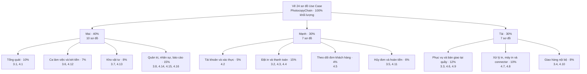

# Phân công vẽ sơ đồ Use Case – CNTT-KLCN031

**Đề tài:** Hệ thống quản lý chuỗi cửa hàng photocopy (PhotocopyChain).

**Căn cứ:** `DeXuat_SoDo_UseCase_CNTT-KLCN031.md`, gồm 8 sơ đồ nghiệp vụ (Chương 3) và 16 sơ đồ hệ thống (Chương 4).

**Phạm vi:** phân công vẽ và hoàn thiện 24 sơ đồ Use Case trong tài liệu, không phải phân công lập trình hệ thống.

**Tỷ lệ đề xuất theo khối lượng ước lượng:** Mai 40%, Mạnh 30%, Tài 30%. Số lượng sơ đồ tương ứng là 10–7–7; tỷ lệ số lượng là 41,7%–29,2%–29,2%, khác với tỷ lệ khối lượng vì độ phức tạp của từng sơ đồ khác nhau. Các trọng số dưới đây dùng để lập kế hoạch, chưa phải số liệu thời gian thực tế.

## 1. Sơ đồ phân công

## 2. Danh sách sơ đồ từng thành viên

### Mai – 40% khối lượng, 10 sơ đồ

| Mã | Sơ đồ phụ trách |
| :--- | :--- |
| 3.1 | Tổng quát nghiệp vụ chuỗi photocopy |
| 3.6 | Quản lý ca làm việc và két tiền |
| 3.7 | Nhập kho vật tư: lập phiếu, duyệt, nhận hàng |
| 3.8 | Quản trị chuỗi |
| 4.1 | Tổng quát hệ thống |
| 4.12 | Ca làm việc và két tiền |
| 4.13 | Kho vật tư |
| 4.14 | Danh mục và cấu hình chuỗi |
| 4.15 | Nhân sự và khách hàng |
| 4.16 | Báo cáo và giám sát |

Mai dựng khung hai sơ đồ tổng quát, sau đó cập nhật theo các sơ đồ chi tiết do Mạnh và Tài bàn giao. Khi tổng hợp, thống nhất tên tác nhân, tên use case và cách đánh số hình; việc này nằm trong phần tổng quát đã phân công.

### Mạnh – 30% khối lượng, 7 sơ đồ

| Mã | Sơ đồ phụ trách |
| :--- | :--- |
| 3.2 | Đặt in trực tuyến và thanh toán trước |
| 3.5 | Hủy đơn và hoàn tiền |
| 4.2 | Tài khoản và xác thực |
| 4.3 | Đặt in trên App |
| 4.4 | Thanh toán VietQR |
| 4.5 | Theo dõi đơn (Khách) |
| 4.11 | Hủy đơn và hoàn tiền |

Mạnh làm rõ luồng đặt in, thanh toán trước, hủy và hoàn tiền; thể hiện đúng OTP, đăng nhập Google, payOS, Geoapify và bộ hẹn giờ ở các sơ đồ hệ thống tương ứng.

### Tài – 30% khối lượng, 7 sơ đồ

| Mã | Sơ đồ phụ trách |
| :--- | :--- |
| 3.3 | Phục vụ khách tại quầy |
| 3.4 | Giao hàng tận nơi bằng shipper nội bộ |
| 4.6 | Lập đơn tại quầy |
| 4.7 | Tiếp nhận và xử lý in |
| 4.8 | Máy in và connector |
| 4.9 | Bàn giao tại quầy |
| 4.10 | Giao hàng nội bộ |

Tài làm rõ luồng tiếp nhận, xử lý in, bàn giao và giao hàng; bao gồm máy quét ảo, ảnh thẻ, phục hồi file, điều khiển máy in, in lại, mua thêm và phân công shipper theo tài liệu nguồn.

## 3. Quy trình phối hợp và bàn giao

1. Mai thống nhất khung tác nhân, quy tắc đặt tên và bố cục chung với Mạnh, Tài trước khi vẽ chi tiết.
2. Ba thành viên vẽ phần được giao. Mỗi sơ đồ có một người chịu trách nhiệm chính như bảng trên.
3. Mạnh và Tài thống nhất điểm chuyển tiếp: thanh toán thành công sang hàng đợi in; kết quả in sang bàn giao hoặc giao hàng; điều kiện hủy đơn liên quan đến trạng thái xử lý.
4. Kiểm tra chéo: Mai rà phần Mạnh, Mạnh rà phần Tài, Tài rà phần Mai. Mỗi người tự sửa sơ đồ mình phụ trách.
5. Mai tổng hợp và cập nhật sơ đồ 3.1, 4.1; cả nhóm kiểm tra đủ 24 sơ đồ trước khi bàn giao.

**Sản phẩm mỗi sơ đồ:** file nguồn chỉnh sửa được, ảnh xuất rõ chữ và mô tả ngắn phạm vi/tác nhân. Tên file bắt đầu bằng mã sơ đồ để dễ đối chiếu.

## 4. Tiêu chí kiểm tra theo tài liệu nguồn

- Phân biệt sơ đồ nghiệp vụ với sơ đồ hệ thống: Ngân hàng và Nhà cung cấp vật tư chỉ thuộc sơ đồ nghiệp vụ; các dịch vụ ngoài như payOS, Google, Gmail, Geoapify và connector chỉ đưa vào sơ đồ hệ thống phù hợp.
- Sơ đồ giao hàng không có COD hoặc đối soát tiền COD; đơn App thanh toán VietQR trước. Tiền mặt chỉ thu khi bàn giao tại quầy.
- Không thêm danh mục nhà cung cấp, đối soát in lậu hoặc cấu hình phí ship theo bậc km của CEO.
- Thể hiện đúng phân quyền của 5 vai trò; không gán mọi chức năng cho mọi tác nhân.
- Kiểm tra các chức năng mới được liệt kê trong tài liệu nguồn và tính nhất quán giữa sơ đồ tổng quát, nghiệp vụ và hệ thống.

**Tổng kiểm:** Mai 10 + Mạnh 7 + Tài 7 = 24 sơ đồ; khối lượng kế hoạch 40% + 30% + 30% = 100%.
