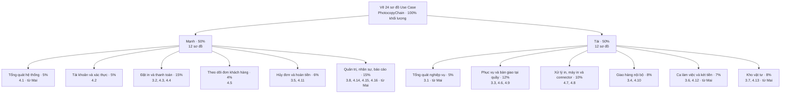

# Phân công vẽ sơ đồ Use Case – CNTT-KLCN031

**Đề tài:** Hệ thống quản lý chuỗi cửa hàng photocopy (PhotocopyChain).

**Căn cứ:** `DeXuat_SoDo_UseCase_CNTT-KLCN031.md`, gồm 8 sơ đồ nghiệp vụ (Chương 3) và 16 sơ đồ hệ thống (Chương 4).

**Phạm vi:** phân công vẽ và hoàn thiện 24 sơ đồ Use Case trong tài liệu, không phải phân công lập trình hệ thống.

**Tỷ lệ đề xuất theo khối lượng ước lượng:** Mạnh 50%, Tài 50%. Số lượng sơ đồ tương ứng là 12–12. Phần của Mai trước đây (10 sơ đồ, 40%) được chia đều cho hai người; mỗi người nhận một sơ đồ tổng quát. Các trọng số dưới đây dùng để lập kế hoạch, chưa phải số liệu thời gian thực tế.

## 1. Sơ đồ phân công

## 2. Danh sách sơ đồ từng thành viên

### Mạnh – 50% khối lượng, 12 sơ đồ

| Mã | Sơ đồ phụ trách | Nguồn |
| :--- | :--- | :--- |
| 3.2 | Đặt in trực tuyến và thanh toán trước | Mạnh |
| 3.5 | Hủy đơn và hoàn tiền | Mạnh |
| 3.8 | Quản trị chuỗi | **Nhận từ Mai** |
| 4.1 | Tổng quát hệ thống | **Nhận từ Mai** |
| 4.2 | Tài khoản và xác thực | Mạnh |
| 4.3 | Đặt in trên App | Mạnh |
| 4.4 | Thanh toán VietQR | Mạnh |
| 4.5 | Theo dõi đơn (Khách) | Mạnh |
| 4.11 | Hủy đơn và hoàn tiền | Mạnh |
| 4.14 | Danh mục và cấu hình chuỗi | **Nhận từ Mai** |
| 4.15 | Nhân sự và khách hàng | **Nhận từ Mai** |
| 4.16 | Báo cáo và giám sát | **Nhận từ Mai** |

Tổng: 7 sơ đồ của Mạnh + 5 sơ đồ nhận từ Mai.

Mạnh làm rõ luồng đặt in, thanh toán trước, hủy và hoàn tiền; thể hiện đúng OTP, đăng nhập Google, payOS, Geoapify và bộ hẹn giờ ở các sơ đồ hệ thống tương ứng. Mạnh phụ trách thêm phần quản trị chuỗi (danh mục, cấu hình, nhân sự, khách hàng, báo cáo) và dựng sơ đồ tổng quát hệ thống 4.1 từ 15 sơ đồ hệ thống chi tiết 4.2–4.16 của cả hai người.

### Tài – 50% khối lượng, 12 sơ đồ

| Mã | Sơ đồ phụ trách | Nguồn |
| :--- | :--- | :--- |
| 3.1 | Tổng quát nghiệp vụ chuỗi photocopy | **Nhận từ Mai** |
| 3.3 | Phục vụ khách tại quầy | Tài |
| 3.4 | Giao hàng tận nơi bằng shipper nội bộ | Tài |
| 3.6 | Quản lý ca làm việc và két tiền | **Nhận từ Mai** |
| 3.7 | Nhập kho vật tư: lập phiếu, duyệt, nhận hàng | **Nhận từ Mai** |
| 4.6 | Lập đơn tại quầy | Tài |
| 4.7 | Tiếp nhận và xử lý in | Tài |
| 4.8 | Máy in và connector | Tài |
| 4.9 | Bàn giao tại quầy | Tài |
| 4.10 | Giao hàng nội bộ | Tài |
| 4.12 | Ca làm việc và két tiền | **Nhận từ Mai** |
| 4.13 | Kho vật tư | **Nhận từ Mai** |

Tổng: 7 sơ đồ của Tài + 5 sơ đồ nhận từ Mai.

Tài làm rõ luồng tiếp nhận, xử lý in, bàn giao và giao hàng; bao gồm máy quét ảo, ảnh thẻ, phục hồi file, điều khiển máy in, in lại, mua thêm và phân công shipper theo tài liệu nguồn. Tài phụ trách thêm phần vận hành tại chi nhánh (ca làm việc, két tiền, kho vật tư) và dựng sơ đồ tổng quát nghiệp vụ 3.1 từ 7 sơ đồ nghiệp vụ chi tiết 3.2–3.8 của cả hai người.

### Đối chiếu phần của Mai (10 sơ đồ, 40%) sau khi chia lại

| Mã | Sơ đồ của Mai trước đây | Khối lượng | Chuyển cho |
| :--- | :--- | :--- | :--- |
| 3.1 | Tổng quát nghiệp vụ chuỗi photocopy | 5% | Tài |
| 4.1 | Tổng quát hệ thống | 5% | Mạnh |
| 3.6 | Quản lý ca làm việc và két tiền | 7% (cùng 4.12) | Tài |
| 4.12 | Ca làm việc và két tiền | | Tài |
| 3.7 | Nhập kho vật tư: lập phiếu, duyệt, nhận hàng | 8% (cùng 4.13) | Tài |
| 4.13 | Kho vật tư | | Tài |
| 3.8 | Quản trị chuỗi | 15% (cùng 4.14, 4.15, 4.16) | Mạnh |
| 4.14 | Danh mục và cấu hình chuỗi | | Mạnh |
| 4.15 | Nhân sự và khách hàng | | Mạnh |
| 4.16 | Báo cáo và giám sát | | Mạnh |

Mạnh nhận 5 sơ đồ (4.1, 3.8, 4.14, 4.15, 4.16) = 20%; Tài nhận 5 sơ đồ (3.1, 3.6, 4.12, 3.7, 4.13) = 20%.

## 3. Quy trình phối hợp và bàn giao

1. Mạnh và Tài thống nhất khung tác nhân, quy tắc đặt tên và bố cục chung trước khi vẽ chi tiết.
2. Hai thành viên vẽ phần được giao. Mỗi sơ đồ có một người chịu trách nhiệm chính như bảng trên.
3. Thống nhất điểm chuyển tiếp: thanh toán thành công sang hàng đợi in; kết quả in sang bàn giao hoặc giao hàng; điều kiện hủy đơn liên quan đến trạng thái xử lý; cấu hình chuỗi (4.14) và nhân sự (4.15) dùng cho ca làm việc, kho vật tư tại chi nhánh.
4. Kiểm tra chéo: Mạnh rà phần Tài, Tài rà phần Mạnh. Mỗi người tự sửa sơ đồ mình phụ trách.
5. Tổng hợp: mỗi người bàn giao sơ đồ chi tiết cho người làm tổng quát tương ứng. Mạnh cập nhật 4.1, Tài cập nhật 3.1; hai người đối chiếu 3.1 với 4.1 để tên tác nhân, tên use case và cách đánh số hình khớp nhau, rồi cùng kiểm tra đủ 24 sơ đồ trước khi bàn giao.

**Sản phẩm mỗi sơ đồ:** file nguồn chỉnh sửa được, ảnh xuất rõ chữ và mô tả ngắn phạm vi/tác nhân. Tên file bắt đầu bằng mã sơ đồ để dễ đối chiếu.

## 4. Tiêu chí kiểm tra theo tài liệu nguồn

- Phân biệt sơ đồ nghiệp vụ với sơ đồ hệ thống: Ngân hàng và Nhà cung cấp vật tư chỉ thuộc sơ đồ nghiệp vụ; các dịch vụ ngoài như payOS, Google, Gmail, Geoapify và connector chỉ đưa vào sơ đồ hệ thống phù hợp.
- Sơ đồ giao hàng không có COD hoặc đối soát tiền COD; đơn App thanh toán VietQR trước. Tiền mặt chỉ thu khi bàn giao tại quầy.
- Không thêm danh mục nhà cung cấp, đối soát in lậu hoặc cấu hình phí ship theo bậc km của CEO.
- Thể hiện đúng phân quyền của 5 vai trò; không gán mọi chức năng cho mọi tác nhân.
- Kiểm tra các chức năng mới được liệt kê trong tài liệu nguồn và tính nhất quán giữa sơ đồ tổng quát, nghiệp vụ và hệ thống.

**Tổng kiểm:** Mạnh 12 + Tài 12 = 24 sơ đồ; khối lượng kế hoạch 50% + 50% = 100%.

## 5. Bàn giao bổ sung phần Mạnh — 29/10/2026

Đã hoàn thành **5 sơ đồ Mạnh nhận từ Mai**, đối chiếu code hiện tại. Không thay đổi phân công của Tài hoặc ghi đè bảy hình cũ của Mạnh.

| Mã | Sơ đồ | Kết quả |
| --- | --- | --- |
| 3.8 | Quản trị chuỗi — nghiệp vụ | draw.io chỉnh sửa được, PNG, SVG và mô tả luồng |
| 4.1 | Tổng quát hệ thống | Bao quát 15 phân hệ 4.2–4.16; thể hiện thêm OCR hiện có |
| 4.14 | Danh mục và cấu hình chuỗi | Phân biệt quyền CEO/quản lý; có mẫu đơn, bảo trì, phạm vi chi nhánh |
| 4.15 | Nhân sự và khách hàng | Đúng quyền tạo/khóa nhân viên, quản lý khách và ẩn đánh giá |
| 4.16 | Báo cáo và giám sát | Dashboard, doanh thu theo kỳ, cơ cấu dịch vụ/thanh toán, cảnh báo vận hành |

- [Mở file draw.io tổng hợp 5 trang](docs/so-do-manh/nhan-tu-mai/MANH_5_SO_DO_NHAN_TU_MAI.drawio).
- [Danh sách ảnh và hướng dẫn](docs/so-do-manh/nhan-tu-mai/README.md).
- [Phân tích luồng và căn cứ source](docs/so-do-manh/nhan-tu-mai/PHAN_TICH_VA_DOI_CHIEU_BO_SUNG.md).
- Bản chép dễ tìm: `C:\Users\USER\Desktop\DA_CN\Sơ đồ\Usecase\BoSung_TuMai`.

Đã kiểm tra đủ năm mã, nguồn tổng hợp năm trang, actor/oval trong đúng phạm vi, không tràn chữ và không có đường nối xuyên oval khác. Đây là kiểm tra tài liệu với source, không phải nghiệm thu thanh toán/in thật. Bảy sơ đồ gốc vẫn giữ nguyên bản đã bàn giao; đợt này không rà lại toàn bộ nội dung cũ hoặc làm các sơ đồ thuộc Tài.
